# Q1 · Which genes differ in early-onset preeclampsia placentas?

This folder holds the gene-level analysis for the [Q1 primary comparison](../../Q01-placental-gene-expression.md#primary-comparison-decision): placental villous RNA at delivery in **8 pregnancies with early-onset preeclampsia without fetal growth restriction (`EOPE`) versus 5 with spontaneous idiopathic preterm birth (`iPTB`)**. It follows the [earlier log-CPM PCA](../README.md), which showed a broad difference between the two groups and raised two concerns: delivery age and one unusual sample, S22.

The page is written for a reader who is new to RNA-seq. Every plot is shown with a note on how to read it, and a [glossary](#glossary) is at the end. Run on November 14, 2026 against the organizer data package v1.0.0.

## What we found

- **352 genes differ** between EOPE and iPTB placentas by at least 2-fold with an adjusted p-value below 0.05. **207 of them hold up in all four versions of the analysis.**
- **The four genes named in advance** (`FLT1`, `ENG`, `LEP`, `INHBA`) are all higher in EOPE in every version.
- **Delivery age does not explain the result.** The fold changes barely move when delivery age is adjusted for or when only pregnancies of matching delivery age are compared.
- **S22 is an unusual sample with little influence.** Leaving it out changes the direction of none of the 352 genes. It stays in the main analysis.
- **Open concerns.** The study has 13 pregnancies. One control (S24) pulls on many genes, read depth differs between the groups, and fetal sex is unbalanced and not yet modelled.

## Contents

1. [Background](#1-background)
2. [How to rerun it](#2-how-to-rerun-it)
3. [Choices fixed before looking at gene results](#3-choices-fixed-before-looking-at-gene-results)
4. [Who is being compared: delivery age](#4-who-is-being-compared-delivery-age)
5. [Sequencing quality](#5-sequencing-quality)
6. [PCA: do whole samples look alike?](#6-pca-do-whole-samples-look-alike)
7. [What DESeq2 does and why we use it](#7-what-deseq2-does-and-why-we-use-it)
8. [Gene-level results](#8-gene-level-results)
9. [Does S22 drive the result?](#9-does-s22-drive-the-result)
10. [What to carry forward](#10-what-to-carry-forward)
11. [Plots the Q1 plan asks for](#11-plots-the-q1-plan-asks-for)
12. [Glossary](#glossary)

## 1. Background

**The data.** Each of 30 pregnancies gave one piece of placental villous tissue at delivery. RNA from the tissue was sequenced into millions of short **reads**, and each read was matched to the gene it came from. The result is a **count table**: for every gene and every sample, the number of reads that landed on that gene. More reads on a gene means the gene was more active in that tissue. [Count table](../../openbio-datathon-2026/track-01/data/track01_counts_vt.csv) · [Sample information](../../openbio-datathon-2026/track-01/data/track01_metadata_vt.csv)

**The five clinical groups.**

| Group | Meaning | Pregnancies |
| --- | --- | ---: |
| `EOPE` | Early-onset preeclampsia without fetal growth restriction | 8 |
| `iPTB` | Spontaneous preterm birth with no known cause. These are the controls. | 5 |
| `EOPE+FGR` | Early-onset preeclampsia with fetal growth restriction | 7 |
| `FGR` | Fetal growth restriction alone | 5 |
| `TB` | Term birth | 5 |

**Why EOPE versus iPTB.** Placental gene activity changes as pregnancy advances. EOPE placentas are delivered early, so comparing them with term placentas would mix the effect of disease with the effect of delivery age. The iPTB pregnancies also delivered early and had neither preeclampsia nor growth restriction.

**How this folder fits with the earlier work.**

| Step | Question | Where |
| --- | --- | --- |
| Log-CPM PCA | Do the samples group by diagnosis at all? Which comparison is fair? | [`PCA/`](../README.md) |
| Delivery age, sequencing quality, VST PCA | Are the groups comparable? Is any sample unusual? | This folder, sections 4–6 |
| DESeq2 fits | Which genes differ, by how much, and how sure are we? | This folder, sections 7–9 |

## 2. How to rerun it

From the OpenBio root, with the organizer checkout in place:

```sh
python -m pip install -r openbio-datathon-2026/environment/requirements.txt
cd "PCA/VST DESeq2"
python vst_pca.py        # delivery age, sequencing quality, and PCA: about 30 seconds
python deseq2_fits.py    # DESeq2 fits: about 2 minutes
```

Both scripts read the three released organizer files and write every table and plot under `results/`. Nothing is entered by hand. [`common.py`](common.py) holds the shared loading checks and cohort definitions. Package versions and the sample IDs in each fit are recorded in [`run_info.json`](results/deseq2/run_info.json).

## 3. Choices fixed before looking at gene results

Setting these in advance keeps the analysis from being tuned to a preferred answer.

- **Cutoffs.** A gene "passes" when its adjusted p-value (`padj`) is below **0.05** and it differs at least **2-fold** in either direction (`|log2FoldChange| ≥ 1`).
- **Benchmark genes.** `FLT1`, `ENG`, `LEP`, and `INHBA`, from the Q1 plan.
- **DESeq2 settings.** PyDESeq2 0.5.4 defaults, as in the organizer notebook. Every fit uses raw counts with one sample per pregnancy.
- **No exclusions.** S22 stays in the primary fit. Fit D leaves it out only to measure its influence.

## 4. Who is being compared: delivery age

All five iPTB controls and five of the eight EOPE pregnancies delivered between 29.857 and 33.000 weeks. The term births have no overlap with any other group.

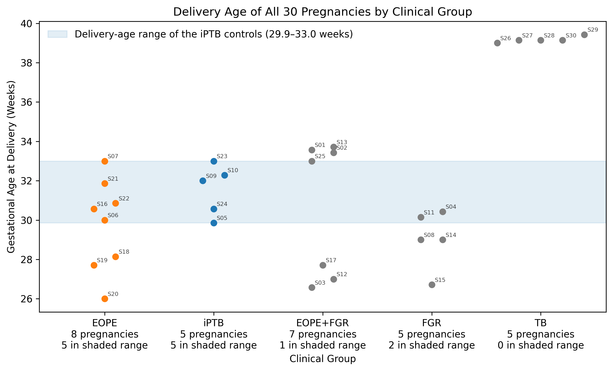

**Figure 1. Delivery age in all five groups.** Each dot is one pregnancy. The blue band marks the delivery ages of the iPTB controls. Orange and blue dots are the two groups in the Q1 comparison.

**How to read it.** Dots inside the band delivered at the same ages as the controls. The term births at the top right are six weeks later than any other pregnancy, which is why they are not used as the comparison group.

| Group | Pregnancies | Delivery age, weeks | Inside the iPTB range |
| --- | ---: | ---: | ---: |
| `EOPE` | 8 | 26.0–33.0 | 5 |
| `iPTB` | 5 | 29.9–33.0 | 5 |
| `EOPE+FGR` | 7 | 26.6–33.7 | 1 |
| `FGR` | 5 | 26.7–30.4 | 2 |
| `TB` | 5 | 39.0–39.4 | 0 |

The three EOPE pregnancies outside the band (S18, S19, S20) all delivered earlier than any control, at 26.0–28.1 weeks. Two of the DESeq2 fits in section 8 exist to deal with this. Fit B adjusts for delivery age across all 13 pregnancies. Fit C keeps only the 10 inside the band.

## 5. Sequencing quality

S22 has the fewest gene-assigned reads of the 13 pregnancies and the most genes detected. [QC table](results/qc/sequencing_qc.csv)

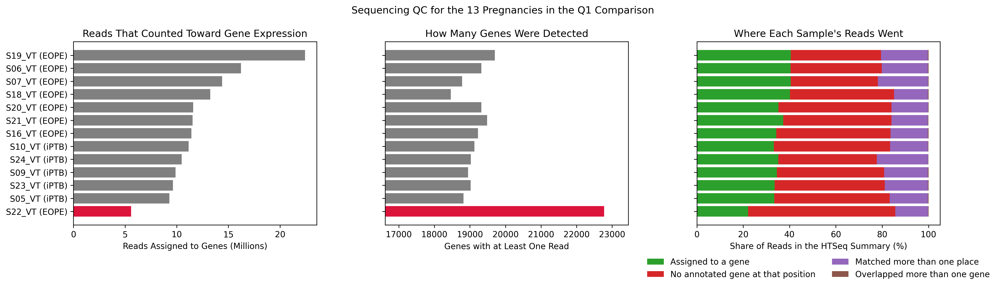

**Figure 2. Sequencing quality in the 13 pregnancies.** S22 is in red. Left: reads that landed on a known gene. Middle: genes with at least one read. Right: where each sample's reads went.

**How to read it.** A sample with fewer usable reads would be expected to detect fewer genes. S22 has the shortest bar on the left and the longest in the middle, which is the opposite. On the right, the red section (reads that landed where no gene is annotated) is largest for S22.

| Measure | S22 | Other 12 pregnancies |
| --- | ---: | ---: |
| Reads assigned to genes | 5.59 million | 9.28–22.42 million |
| Share of reads assigned to genes | 22.1% | 33.2–40.6% |
| Share with no annotated feature | 63.5% | 37.6–50.2% |
| Genes with at least one read | 22,774 | 18,460–19,703 |
| Genes detected in no other Q1 sample | 1,267 | 29–61 |

Percentages are of the reads in the released HTSeq summary. The 1,267 genes seen only in S22 carry 2,739 reads in total, a median of 2 reads each. S22's library therefore spreads a small number of reads across many genes that are silent in the other pregnancies, and most of its reads fall outside annotated genes. Reads from genomic DNA or unspliced RNA would be one way to produce this pattern. That is speculation from count-level data. Alignment-level QC would be needed to check it.

**Why this matters for Q1.** S22 is one of only eight EOPE samples. In groups this small, one unreliable sample could create or hide gene differences. The QC does not show that S22's measurements are wrong. It shows which sample to test, and [section 9](#9-does-s22-drive-the-result) is that test.

**Read depth also differs between the groups.** Among the other 12 pregnancies, the five iPTB controls have 9.3–11.2 million assigned reads and the seven remaining EOPE cases have 11.4–22.4 million (Pearson `r = 0.67` between log depth and group).

## 6. PCA: do whole samples look alike?

**What PCA is.** Each sample has a count for more than 24,000 genes, which cannot be looked at directly. Principal component analysis (PCA) finds the few directions along which the samples differ most and draws each sample as a dot. PC1 is the direction with the most variation and PC2 is the next. Dots close together have similar overall gene activity. PCA does not use the diagnosis. The colors are added afterward, so any grouping it shows was not put there by us.

**What PCA cannot do.** It gives a picture of whole samples. It does not say which genes differ, by how much, or whether the difference could be chance. That is the job of DESeq2 in section 7.

### Where this started: all 30 pregnancies

The [earlier PCA](../results/all_villous/README.md) used all 30 samples with the organizer's `log2(CPM + 1)` scaling. The three plots below are the same picture with different colors.

| Colored by group | Colored by delivery age | Colored by fetal sex |
| --- | --- | --- |
| 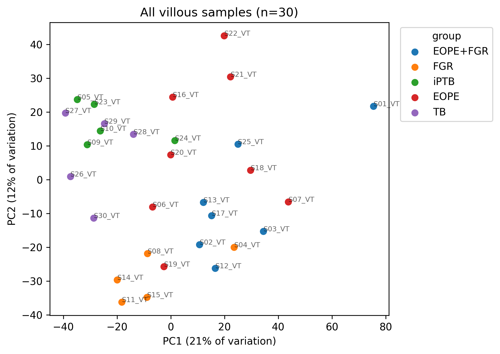 | 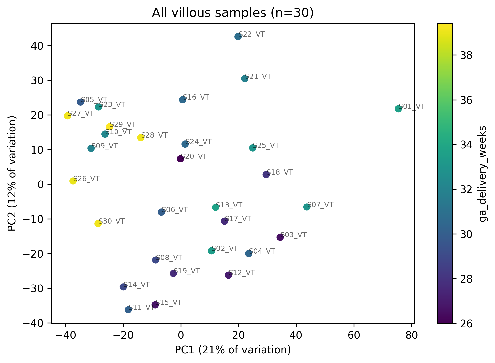 | 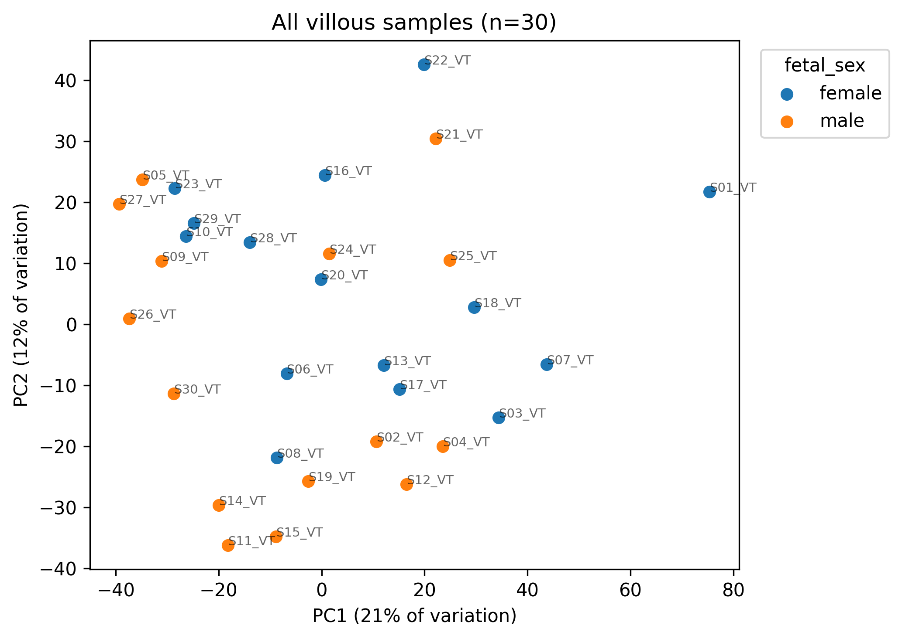 |

**Figure 3. Log-CPM PCA of all 30 pregnancies.** PC1 and PC2 carry 20.9% and 12.5% of the variation.

**How to read it.** Most iPTB controls (green, left plot) and all term births sit at the left. EOPE samples (red) spread to the right. Delivery age and fetal sex show no clean left-to-right pattern. This is what led to the EOPE-versus-iPTB comparison. [Preterm-only](../results/preterm/README.md) · [13 pregnancies](../results/eope_vs_iptb/README.md) · [10 pregnancies](../results/shared_age/README.md)

### Two ways to scale counts before PCA

Raw counts cannot go straight into PCA, because a handful of very active genes would dominate. The counts are rescaled first, and there are two common ways.

- **`log2(CPM + 1)`, used in the earlier PCA.** Each count is divided by the sample's total reads (counts per million), then logged. It is simple and transparent. Its weak point is genes with very few reads. One read is worth about four times as much CPM in S22 as in the deepest sample, so chance differences of a read or two can look large in a low-depth sample.
- **VST, used here.** The variance-stabilizing transformation comes from DESeq2. It learns from the data how noisy genes are at each level of activity and rescales so that low-count and high-count genes vary by similar amounts. Low-count noise is damped.

S22 was the lowest-depth sample and sat alone in the log-CPM PCA. The question was whether that was real or a side effect of low-count noise. If VST pulled S22 back toward the others, the earlier picture would have been partly a scaling effect.

### The 13 pregnancies in the comparison

**VST did not change the picture.** The read-depth pattern did not weaken, S22 stayed the most isolated sample, and the EOPE–iPTB shift is still visible. [Component table](results/vst_pca/component_associations.csv) · [Summary](results/vst_pca/summary.csv)

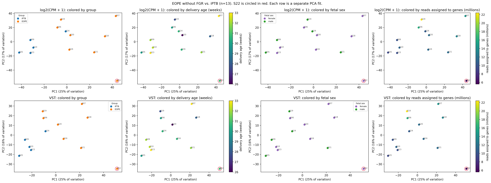

**Figure 4. Log-CPM (top row) versus VST (bottom row) in the 13 pregnancies.** Columns color the same dots by group, delivery age, fetal sex, and read depth. S22 is circled in red.

**How to read it.** Compare each top plot with the one below it. The two rows look alike, so the choice of scaling did not create the pattern. The four VST plots are shown larger below.

| | |
| --- | --- |
| 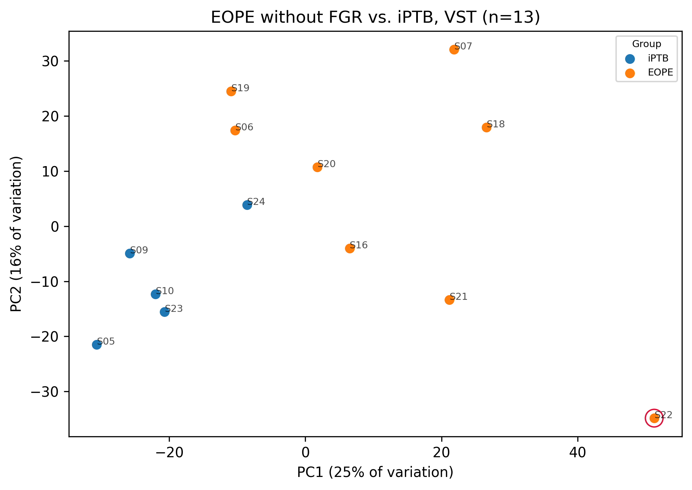 | 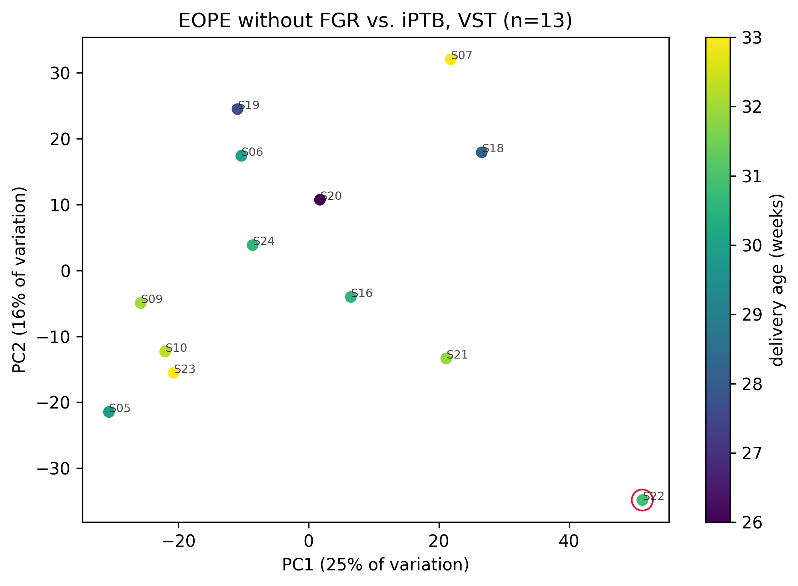 |
| **Figure 5. By group.** Four of five controls (blue) sit at the far left. S24 is the control that falls among the EOPE samples. | **Figure 6. By delivery age.** Early (dark) and late (yellow) deliveries are spread across the plot. Delivery age is not what the main axes show. |
| 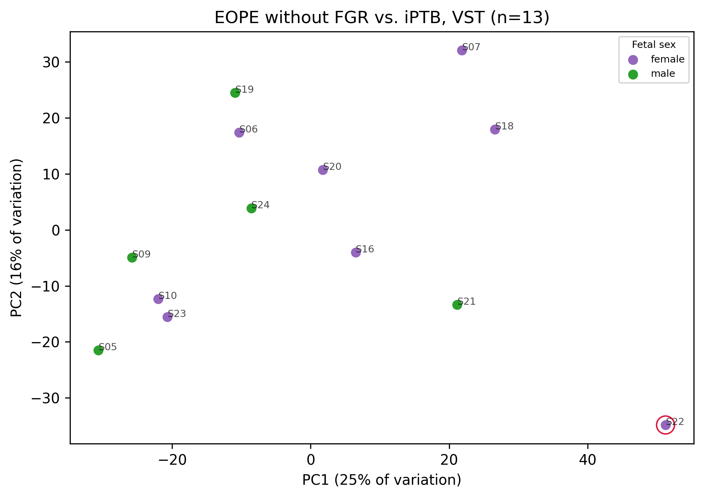 | 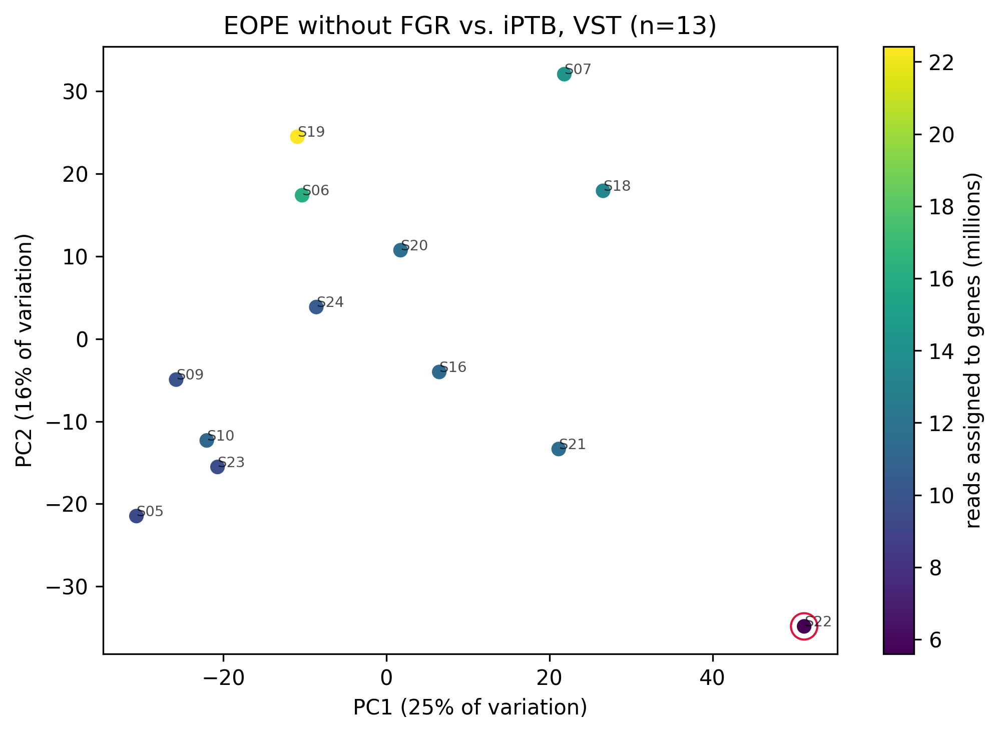 |
| **Figure 7. By fetal sex.** Female and male pregnancies are mixed across both axes. | **Figure 8. By read depth.** Samples with fewer reads (dark) sit lower. The vertical axis follows sequencing depth. |

Each PCA was refitted on the cohort's own samples using every gene with at least one read. VST was fitted without the clinical group. The log-CPM column reproduces the [earlier PCA](../results/eope_vs_iptb/README.md). In the table, `r` is a correlation from 0 (unrelated) to 1 (perfectly related).

| Check | 13 donors, log-CPM | 13 donors, VST | 10 donors, log-CPM | 10 donors, VST |
| --- | ---: | ---: | ---: | ---: |
| PC1, PC2 share of variation | 25.1%, 17.1% | 24.9%, 16.3% | 29.3%, 19.2% | 29.4%, 17.2% |
| PC2 vs. log assigned depth, absolute `r` | 0.87 | 0.85 | 0.86 | 0.82 |
| Same, with S22 left out of the correlation | 0.75 | 0.79 | 0.68 | 0.78 |
| PC1 vs. log assigned depth, absolute `r` | 0.03 | 0.25 | 0.14 | 0.35 |
| PC1 vs. clinical group, absolute `r` | 0.77 | 0.73 | 0.77 | 0.77 |
| iPTB controls outside the EOPE range on PC1 | 4 of 5 | 4 of 5 | 4 of 5 | 4 of 5 |
| PC1 vs. delivery age, absolute `r` | 0.10 | 0.07 | 0.10 | 0.04 |
| PC1 vs. fetal sex, absolute `r` | 0.32 | 0.37 | 0.23 | 0.27 |
| PC2 vs. fetal sex, absolute `r` | 0.12 | 0.10 | 0.11 | 0.09 |
| S22 isolation ratio (1.0 is a typical sample) | 1.26 | 1.30 | 1.26 | 1.29 |

The isolation ratio is a sample's average distance to the other samples across all genes, divided by the cohort median. S22 is the most isolated sample under both transformations in both cohorts. [Sample isolation](results/vst_pca/sample_isolation.csv)

**Fetal sex.** Fetal sex shows most on PC4, which carries 9–10% of the variation (absolute `r = 0.68` under VST in the 13 donors). The groups are unbalanced: EOPE has 6 female and 2 male pregnancies and iPTB has 2 female and 3 male, so sex and group overlap at `r = 0.35` in the 13 donors and `0.41` in the 10. The PC1 association with sex is that size or smaller, and PC1 follows group far more closely. None of the DESeq2 fits below includes fetal sex.

### The 10 pregnancies with matching delivery age

The same checks give the same answers in the 10 pregnancies inside the delivery-age band.

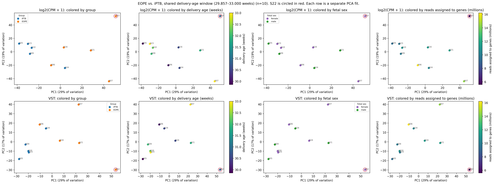

**Figure 9. Log-CPM (top row) versus VST (bottom row) in the 10 pregnancies of matching delivery age.** The layout matches Figure 4.

**How to read it.** Compare each top plot with the one below it, as in Figure 4. The top row is upside down relative to the bottom row: S22 is at the top right above and the bottom right below. The direction of a PCA axis is arbitrary, so a flip carries no meaning. What matters is which dots are near which. In both rows four of the five controls sit together at the left, S24 falls among the EOPE samples, and S22 sits apart from everything else. Leaving out the three earliest EOPE deliveries did not remove the pattern.

<details>
<summary>Larger versions of the four VST plots for the 10 pregnancies</summary>

These are the four bottom-row plots of Figure 9 at a larger size. They are read the same way as Figures 5–8.

| | |
| --- | --- |
| 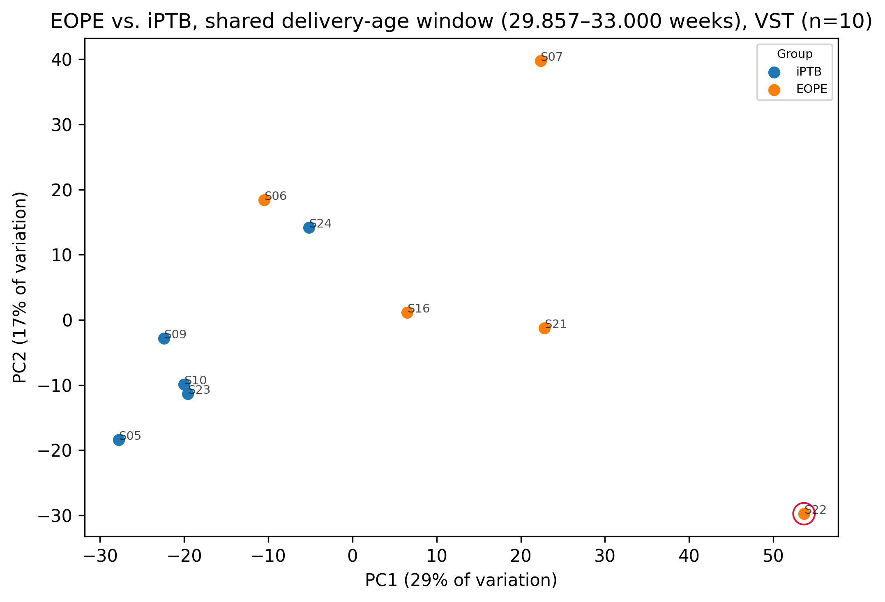 | 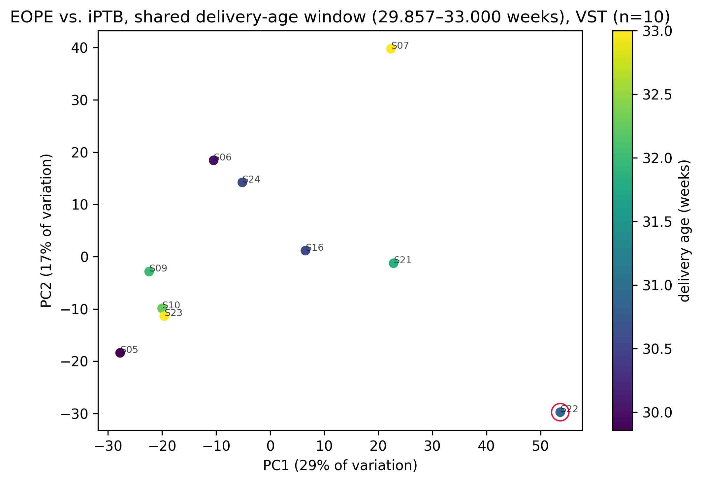 |
| 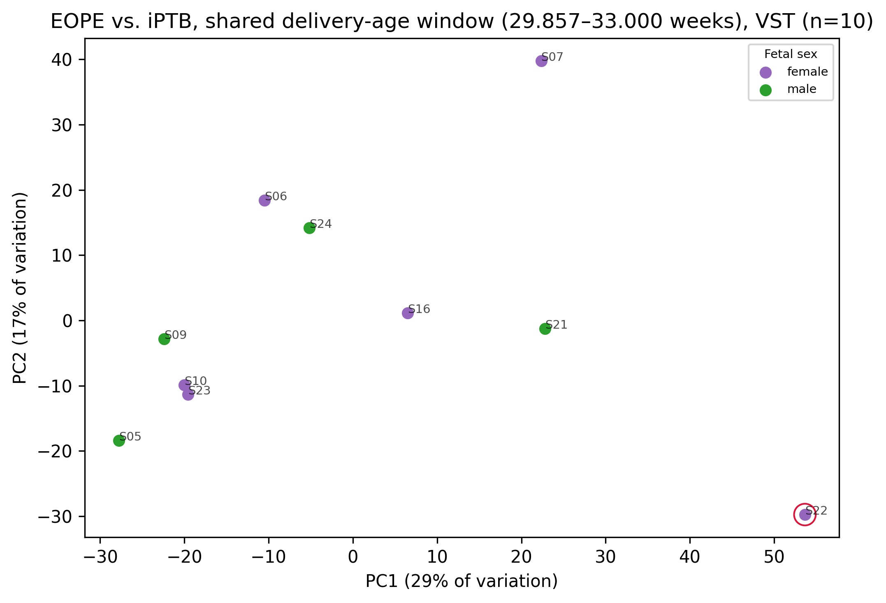 | 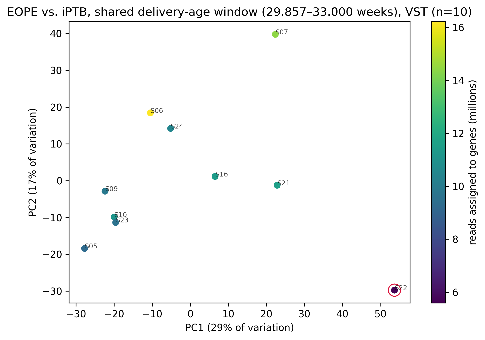 |

</details>

**Reading.** S22's expression profile is unusual under both transformations, so noisy low counts under `log2(CPM + 1)` do not explain its position. The depth association on PC2 also holds among the other 12 pregnancies, so it describes the cohort and does not rest on S22 alone. Sequencing or library effects and biological differences both remain possible. The gene-level refit in section 9 is the direct measure of S22's effect on Q1.

## 7. What DESeq2 does and why we use it

PCA showed that EOPE and iPTB placentas differ overall. DESeq2 answers the next question, one gene at a time: **is this gene more or less active in EOPE, by how much, and how sure are we?** It is the method in the organizer's notebook, and PyDESeq2 is its Python version. [DESeq2 paper](https://genomebiology.biomedcentral.com/articles/10.1186/s13059-014-0550-8) · [PyDESeq2 documentation](https://pydeseq2.readthedocs.io/) · [Organizer workflow](../../openbio-datathon-2026/track-01/3-workflow.md)

### What it does, step by step

DESeq2 starts from the raw counts. It needs whole-number counts because the size of a count tells it how precise the measurement is: a gene with 10 reads is measured much less precisely than a gene with 10,000.

1. **Put the samples on one scale.** Samples were sequenced to different depths, so a raw count of 100 means different things in different samples. DESeq2 gives each sample one number, its **size factor**, and divides that sample's counts by it. The size factor is found by comparing each gene's count in the sample with that gene's typical count across all samples, then taking the middle value of those ratios. In fit A the size factors run from 0.49 for S22 to 1.93 for S19, so S22's counts are roughly doubled and S19's roughly halved. [Size factors](results/deseq2/cooks_by_sample_fit_A.csv)
2. **Measure how much each gene naturally varies.** Two pregnancies with the same diagnosis never give the same count. DESeq2 estimates each gene's **dispersion**, its spread between pregnancies in the same group. With 5 to 8 pregnancies per group, a spread estimated from one gene alone is shaky. DESeq2 therefore looks at all genes together, learns how much genes of similar activity usually vary, and pulls each gene's estimate toward that typical value. This sharing of information across genes is the main reason the method works with small groups.
3. **Fit a model for each gene.** The model says: expected count = size factor × the gene's baseline level × the group effect. The group effect is reported as the **log₂ fold change**. A value of +1 means twice as high in EOPE, +2 means four times, and −1 means half. Other terms can be added. Fit B adds delivery age, so the group effect is estimated after allowing for a delivery-age trend.
4. **Test the group effect.** DESeq2 divides the fold change by its uncertainty (the standard error). A large ratio gives a small **p-value**, meaning a difference that size would rarely appear by chance if the groups were truly the same. We also report a **95% interval**, the fold change plus or minus 1.96 standard errors. A wide interval means the size of the effect is poorly pinned down.
5. **Correct for testing thousands of genes.** Fit A tested 15,453 genes. If no gene truly differed, about 770 would still reach p < 0.05 by chance. In fact 3,376 did. The **adjusted p-value** (`padj`) accounts for this. Among all genes with `padj < 0.05`, about 5% are expected to be false leads. In fit A, 1,172 genes have `padj < 0.05`, and 352 of those also differ at least 2-fold.
6. **Apply two safety checks.** Genes with too few reads to test reliably get no adjusted p-value (8,953 genes in fit A). A count that is extreme for its group is flagged with **Cook's distance**, which measures how hard one sample pulls on a gene's result. Flagged counts are replaced or the gene is set aside, depending on group size.

### Why it suits this dataset

- **The data are counts.** DESeq2 is built for read counts and uses the fact that low counts are noisier than high ones.
- **The groups are small.** Sharing information across genes (step 2) gives steadier answers from 8 and 5 pregnancies than treating each gene alone.
- **Depth varies four-fold.** Assigned reads run from 5.59 to 22.42 million. Size factors correct for this using the typical gene, so a few very active genes do not distort the scaling.
- **Delivery age needs to be accounted for.** The model can include delivery age alongside group (fit B).
- **We need sizes and uncertainty for each gene.** The Q1 plan asks for fold changes, intervals, and adjusted p-values.
- **It is the organizer's method.** Results can be compared directly with the starter notebook and with other teams.

### How it compares with the earlier PCA

DESeq2 does not replace the PCA. The two answer different questions, and the PCA is still the right tool for seeing overall structure and spotting unusual samples.

| | Log-CPM PCA (earlier) | VST PCA (section 6) | DESeq2 fits (section 8) |
| --- | --- | --- | --- |
| Question | Do whole samples look alike? | The same, with different scaling | Which genes differ, by how much, how surely? |
| Uses the diagnosis | No, only to color the dots | No | Yes, it compares the groups |
| Starts from | Counts scaled to CPM and logged | Counts transformed by VST | Raw counts |
| Depth correction | Divide by total reads | Size factors | Size factors |
| Low-count genes | Noisy | Damped | Treated as imprecise, or filtered out |
| Can allow for delivery age | No | No | Yes |
| Gives a result per gene | No | No | Fold change, interval, adjusted p-value |

For the task of finding genes, DESeq2 improves on reading genes off a PCA or running a simple test on log-CPM values in five ways.

1. **It names genes.** PCA shows that samples differ and cannot say which genes are responsible with any measure of confidence.
2. **It knows how precise each count is.** After a log-CPM transformation, a gene with 3 reads and a gene with 3,000 look equally trustworthy. DESeq2 keeps the raw counts, so it does not mistake low-count noise for a real difference.
3. **It gives steadier variability estimates.** A simple test estimates each gene's spread from 13 numbers. DESeq2 shares information across genes.
4. **It controls false leads.** Adjusted p-values account for the 15,453 tests.
5. **It can separate group from delivery age.** A PCA plot can only be recolored.

### What DESeq2 cannot do

- **It cannot separate things that travel together.** Read depth and fetal sex differ between the groups in this cohort, and the circumstances of labor and delivery may too. The model cannot tell those effects from the effect of EOPE unless they are added to it, and 13 pregnancies leave little room to add them.
- **It cannot make a small study large.** The intervals are wide. The fold change for `LEP` could plausibly be anywhere from about 11-fold to about 200-fold.
- **It shows association.** A gene that differs at delivery may be a cause of the disease, a consequence of it, or a sign of a different mix of cell types in the tissue.
- **Large fold changes for low-count genes can be overstated.** These are the default estimates without the optional shrinkage step.

## 8. Gene-level results

### The four fits

One fit answers the question. The other three check whether the answer depends on delivery age or on S22. All four estimate EOPE relative to iPTB, so a positive log₂ fold change means higher RNA abundance in EOPE. [Fit summary](results/deseq2/summary.csv)

| Fit | Pregnancies | Model | What it checks | Genes tested | Passing | Higher in EOPE | Lower in EOPE |
| --- | --- | --- | --- | ---: | ---: | ---: | ---: |
| [A, primary](results/deseq2/fit_A_full.csv) | 8 vs. 5 | `~ group` | The main answer | 15,453 | **352** | 236 | 116 |
| [B, delivery-age adjusted](results/deseq2/fit_B_age_adjusted.csv) | 8 vs. 5 | `~ delivery age + group` | Allows for a delivery-age trend | 15,467 | 383 | 264 | 119 |
| [C, matching delivery age](results/deseq2/fit_C_shared_age.csv) | 5 vs. 5 | `~ group` | Only pregnancies inside the band in Figure 1 | 13,960 | 321 | 227 | 94 |
| [D, without S22](results/deseq2/fit_D_without_S22.csv) | 7 vs. 5 | `~ group` | Whether S22 drives the result | 14,684 | 326 | 208 | 118 |

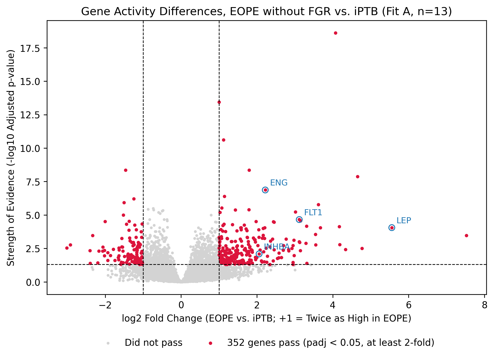

**Figure 10. All tested genes in fit A.** Each dot is one gene. Left to right is the fold change. Bottom to top is the strength of evidence. The 352 red genes pass both cutoffs, shown as dashed lines. The four benchmark genes are circled.

**How to read it.** Genes to the right are higher in EOPE and genes to the left are lower. The higher a dot, the stronger the evidence. Red dots in the upper corners are the genes of interest. There are more on the right (236) than on the left (116).

Of 24,424 genes with reads in fit A, 8,953 received no adjusted p-value under DESeq2's automatic low-count filter and 18 were removed by its outlier rule. The count of passing genes depends on the cutoffs. In fit A it ranges from 74 at a 4-fold cutoff to 1,172 with no fold-change cutoff, and from 195 at `padj < 0.01` to 448 at `padj < 0.10`. [Cutoff sensitivity](results/deseq2/cutoff_sensitivity.csv)

### Benchmark genes

`FLT1`, `ENG`, `LEP`, and `INHBA` were named before the analysis because earlier work on preeclampsia points to them. All four are higher in EOPE and pass the cutoffs in all four fits. [Benchmark table](results/deseq2/benchmark_genes.csv)

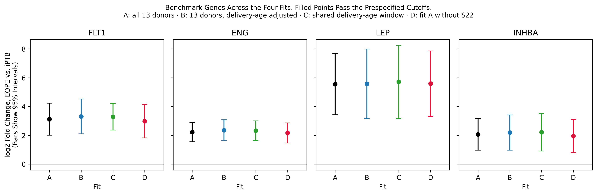

**Figure 11. Fold change of the four benchmark genes in each fit.** Dots are the estimates and bars are the 95% intervals. Filled dots pass the cutoffs. The line at 0 means no difference.

**How to read it.** Within each gene, the four dots sit at nearly the same height, so the estimate does not depend on which version of the analysis is used. No bar reaches 0. The long bars, most of all for `LEP`, show that the exact size of the effect is uncertain.

| Gene | Fit A log₂ fold change (95% interval) | As a fold change | Fit A `padj` | Range of estimates across fits |
| --- | --- | --- | ---: | --- |
| `FLT1` | 3.12 (2.00 to 4.23) | about 8.7-fold | 2.2 × 10⁻⁵ | 2.99 to 3.31 |
| `ENG` | 2.22 (1.55 to 2.89) | about 4.7-fold | 1.4 × 10⁻⁷ | 2.17 to 2.35 |
| `LEP` | 5.56 (3.43 to 7.68) | about 47-fold | 8.8 × 10⁻⁵ | 5.56 to 5.71 |
| `INHBA` | 2.06 (0.96 to 3.15) | about 4.2-fold | 8.1 × 10⁻³ | 1.95 to 2.21 |

These genes were chosen from the source study of this cohort, so agreement reproduces its findings in the same pregnancies. `FLT1` here is gene-level RNA. It does not measure the soluble sFLT1 isoform or circulating protein.

### The same genes, pregnancy by pregnancy

A fold change is a summary of a group. This plot shows the individual pregnancies behind it, in all five groups. [Values](results/deseq2/benchmark_expression_by_donor.csv)

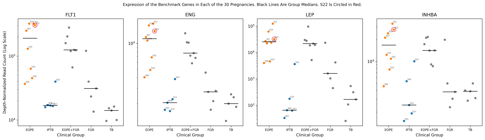

**Figure 12. Depth-normalized counts of the benchmark genes in all 30 pregnancies.** Each dot is one pregnancy. Black lines are group medians. The vertical scale is logarithmic, so each major step is a 10-fold change. S22 is circled in red. Counts are divided by size factors fitted on all 30 samples.

**How to read it.** Compare the orange dots (EOPE) with the blue dots (iPTB) in each panel.

- **The difference is not carried by one or two pregnancies.** For `FLT1`, `ENG`, and `LEP`, every EOPE pregnancy is higher than four of the five controls. For `INHBA` the groups overlap slightly.
- **S24 is the control that looks different.** It is the highest control for all four genes. This is the same S24 that fell among the EOPE samples in Figure 5.
- **EOPE pregnancies vary widely.** `FLT1` runs from about 37,000 to 322,000 across the eight, close to a nine-fold range.
- **S22 sits among the other high EOPE values.** It is not an extreme point for these genes.
- **The other groups give context only.** `EOPE+FGR` looks like `EOPE`, `FGR` sits in between, and term births look like the iPTB controls for `FLT1` and `ENG`. These groups were not tested here.

### Does delivery age explain the result?

No. All 352 fit A genes keep the same direction in fits B, C, and D. [Fit A genes across fits](results/deseq2/fit_A_hits_across_fits.csv)

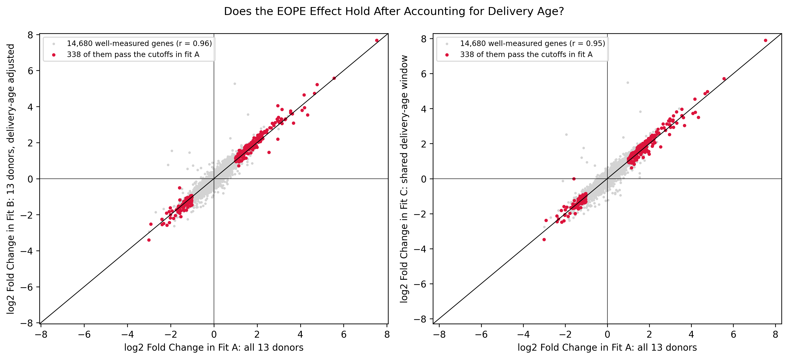

**Figure 13. Fit A against the delivery-age-adjusted fit (left) and the matching-delivery-age fit (right).** Each dot is one gene with enough reads to measure well. Red dots pass the cutoffs in fit A.

**How to read it.** A dot on the diagonal line has the same fold change in both fits. If delivery age were behind the result, the red dots would fall toward the horizontal zero line once age was accounted for. They stay along the diagonal.

| Of the 352 genes passing in fit A | Count |
| --- | ---: |
| Same direction in all four fits | 352 |
| Also pass in fit B, delivery-age adjusted | 289 |
| Also pass in fit C, matching delivery age | 243 |
| Also pass in fit D, without S22 | 290 |
| **Pass in all four fits** | **207** (149 higher, 58 lower in EOPE) |

Across 14,680 well-measured genes (`baseMean ≥ 10`), fit A log₂ fold changes correlate with fit B at `r = 0.96` and with fit C at `r = 0.95`. Fit C has three fewer cases, so some genes drop out there through lost precision. The 207 genes passing in all four fits are the shortlist for browser lookups. Fourteen of the 352 fit A genes have `baseMean` below 10 and none of them is among the 207.

## 9. Does S22 drive the result?

No. Leaving S22 out changes the estimates little. [Influence summary](results/deseq2/s22_influence_summary.csv) · [Gene-level table](results/deseq2/s22_influence.csv)

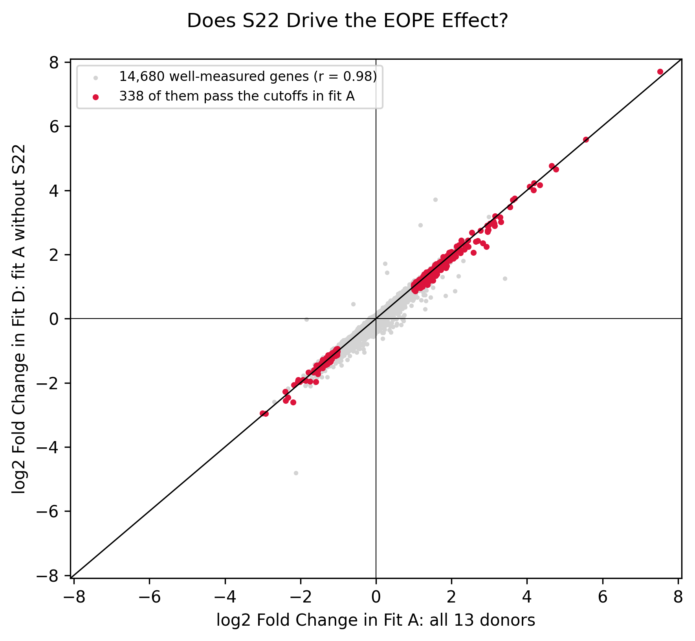

**Figure 14. Fit A against fit D, which leaves S22 out.** The layout matches Figure 13.

**How to read it.** The dots lie close to the diagonal, closer than in Figure 13. Removing S22 changes the fold changes less than accounting for delivery age does.

| Of the 352 genes passing in fit A | Result without S22 |
| --- | --- |
| Same direction | 352 of 352 |
| Estimate still inside fit A's 95% interval | 352 of 352 |
| Median absolute change in log₂ fold change | 0.07 |
| Largest absolute change | 0.68 (`PKD1L2`, 2.92 to 2.24, still passing) |
| Median 95% interval width, fit D relative to fit A | 1.02 |
| Still pass the cutoffs | 290 |

The 62 genes that no longer pass were near the cutoffs. Seventeen keep `padj < 0.05` with a fold change just under 2. Thirty-one have `padj` between 0.05 and 0.11. Fourteen are low-count genes that lose their adjusted p-value under the automatic filter. Thirty-six other genes pass only without S22. Across well-measured genes the two fits correlate at `r = 0.98`.

S22 has the largest Cook's distance for 24 of the 352 genes (6.8%). With 13 donors, an equal share would be 7.7%. [Cook's distance by sample](results/deseq2/cooks_by_sample_fit_A.csv)

### Decision: S22 stays in the primary analysis

S22 is kept in fit A, and fit D is reported beside it as the check.

- **The conclusions do not depend on it.** Without S22, all 352 fit A genes keep their direction, every estimate stays inside fit A's 95% interval, and 290 still pass. `FLT1`, `ENG`, `LEP`, and `INHBA` pass with or without it.
- **Its unusual genes never reach a test.** None of the 1,267 genes seen only in S22 receives an adjusted p-value in fit A, so none can pass. Their counts are too low (highest `baseMean` 1.7).
- **DESeq2 already adjusts for its depth.** Its size factor of 0.49 scales its counts up to match the other samples.
- **Removing it costs a pregnancy.** EOPE would fall from 8 to 7 in a cohort that is already small.
- **The rule was set first.** "No exclusions" was fixed before any gene result was seen. Dropping a sample after seeing its effect would be a choice made with the answer in hand.

**What would have changed this.** Lead genes changing direction, estimates moving outside fit A's intervals, or benchmark genes failing without S22. None of these happened.

**How to report it.** One EOPE sample (S22) had low gene-assigned read depth and an unusual expression profile. It was kept in the primary analysis. Excluding it left all 352 genes in the same direction and 290 still passing. The 207 genes that pass in all four fits do not depend on S22 or on the delivery-age checks, so they are the list to lead with.

## 10. What to carry forward

- **S24 is the donor to check next.** This iPTB control overlaps the EOPE range on PC1 and is the highest control for all four benchmark genes (Figure 12). It has the largest Cook's distance for 16.2% of tested genes, about twice an equal share, for 73 of the 352 fit A genes, and for all four benchmark genes in fit A. A leave-S24-out refit would measure its influence in the same way as fit D. That refit has not been run.
- **Read depth and group overlap in this cohort.** DESeq2's size factors adjust counts for depth. They cannot separate a library-quality difference that travels with depth from a group difference.
- **Fetal sex is unbalanced and not modelled.** EOPE has 6 female and 2 male pregnancies and iPTB has 2 female and 3 male. A fit that includes fetal sex has not been run.
- **Outlier handling differs between fits.** DESeq2 replaces extreme counts only in groups of seven or more identical design rows. It replaced counts for 69 genes in fit A and 42 in fit D, and none in fit C, where both groups have five donors. Fit B has a continuous covariate, so no two donors share a design row and neither the replacement nor the outlier p-value rule applies there.
- **Delivery age was centered in fit B.** Subtracting the cohort mean leaves the group estimate unchanged. With uncentered weeks, 56 genes failed to converge. None of them passed the cutoffs.
- **Scope of the estimates.** These are associations at delivery relative to spontaneous iPTB, where labor and delivery context can also contribute. Bulk villous RNA cannot separate a change in cell mix from a change within cells.

## 11. Plots the Q1 plan asks for

Status against the [Q1 analysis plan](../../Q01-placental-gene-expression.md#analysis) and its figure list.

| Plot in the plan | Status | Where |
| --- | --- | --- |
| Delivery age across all five groups | Done | Figure 1 |
| PCA recolored by group, delivery age, and fetal sex | Done | Figure 3 (all 30), Figures 4–8 (13), Figure 9 (10) |
| Effect sizes and intervals across the primary fits | Done | Figure 11 (benchmark genes), Figure 13 (all genes) |
| Donor-level expression for the lead finding | Done for the benchmark genes | Figure 12 |
| Hallmark pathway results and leading-edge genes | **Not done** | Needs the Hallmark gene sets from the organizer's [`get_gene_sets.py`](../../openbio-datathon-2026/track-01/data/get_gene_sets.py) and a ranking tool that is not yet installed |
| `(EOPE+FGR) − EOPE`, `FGR − iPTB`, and term-birth contrasts | **Not done** | Further DESeq2 fits |
| Cell localization of three result genes | **Not done** | Three lookups in the Zeisel browser |
| `figures/headline.png` | **Not chosen** | Pick after the remaining results are in |

## Glossary

| Term | Meaning |
| --- | --- |
| Villous tissue | The part of the placenta where exchange between mother and fetus takes place |
| Read | One short piece of sequenced RNA |
| Count | The number of reads that landed on a gene in a sample |
| Read depth | The total number of usable reads in a sample |
| CPM | Counts per million: a count divided by the sample's total reads, times one million |
| Size factor | DESeq2's depth correction. Each sample's counts are divided by it. |
| VST | Variance-stabilizing transformation: a rescaling of counts that damps low-count noise, used for PCA |
| PCA, PC1, PC2 | A method that draws each sample as a dot using the directions in which samples differ most. PC1 is the largest. |
| Dispersion | How much a gene's count varies between pregnancies in the same group |
| log₂ fold change | The difference between groups on a doubling scale. +1 is twice as high, +2 is four times, −1 is half. |
| p-value | How often a difference this large would appear by chance if the groups were truly the same |
| Adjusted p-value (`padj`) | A p-value corrected for testing thousands of genes. Below 0.05, about 5% of the genes listed are expected to be false leads. |
| 95% interval | The range of fold changes the data are compatible with |
| `baseMean` | A gene's average depth-normalized count across the samples in a fit |
| Cook's distance | How hard one sample pulls on one gene's result |
| Fit | One run of the DESeq2 model on a chosen set of pregnancies |
| Passing gene | A gene with `padj < 0.05` and at least a 2-fold difference |
