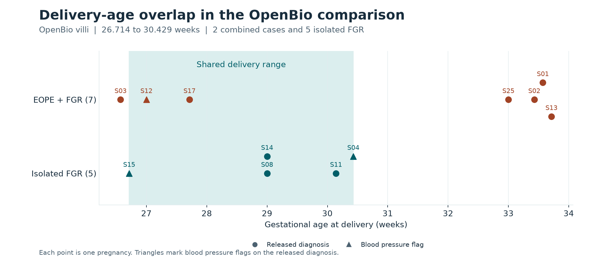

# Placental RNA when preeclampsia and growth restriction occur together

Across three delivery cohorts, placentas from pregnancies with early preeclampsia and fetal growth restriction carried higher RNA for a BMP-centered gene set than placentas from growth restriction alone. In the datathon cohort the difference stayed near +0.3 log₂ after a straight-line adjustment for delivery week, and it stayed in that range after accounting for endothelial and syncytiotrophoblast marker RNA. The shared-week comparison contains only two combined pregnancies, so the size of the age-matched effect is still open. Genes shared with activin signaling contribute to the score, and the decidual difference is at least as large as the villous one.

*Harvard Undergraduate OpenBio Datathon 2026, Track 1*

## A comparison within pregnancies affected by growth restriction

The placenta supplies the developing fetus with oxygen and nutrients. In fetal growth restriction (FGR), the fetus grows less than expected. Some pregnancies with FGR also develop early-onset preeclampsia (EOPE), a high-blood-pressure disorder of pregnancy that starts before 34 weeks. We asked whether the placenta shows an additional RNA shift when both diagnoses occur. The genes belong to bone morphogenetic protein (BMP) signaling, a family of signals used by blood-vessel cells and placental cells. The list also contains receptors, intracellular mediators, and proteins that can block the signal, plus two genes shared with activin, a related pathway. Ackerman and colleagues previously examined the same clinical groups. This analysis measures how large and how consistent that RNA difference is, and whether marker RNA from the likely source cells accounts for it. [Ackerman et al.](https://doi.org/10.1161/HYPERTENSIONAHA.122.20807) · [Reactome BMP signaling](https://reactome.org/content/detail/R-HSA-201451)

## Data and methods

We used villous RNA counts collected at delivery from the OpenBio release of Ackerman’s study, from Awamleh and colleagues, and, as a severe-preeclampsia context, from Piekos and colleagues. After scaling counts for differences among sequencing libraries within each cohort, we averaged the base-2 log expression of 27 curated BMP genes to give every pregnancy one RNA score. Endothelial and syncytiotrophoblast scores used the same scaling and the published identity markers for those classes. A linear model then estimated the BMP-score difference with those marker scores, and with delivery week, included as covariates. Intervals for the adjusted models are HC3. The unadjusted score differences use Welch intervals. A pilot that included the OpenBio and Awamleh cohorts guided the choice of comparison. [Analysis plan](analysis-plan.md) · [OpenBio Track 1 data](https://github.com/Harvard-Undergraduate-OpenBio/openbio-datathon-2026/tree/fb751e91fb1eca4fb26a9658ad9d5042c382c4ba/track-01/data) · [Awamleh et al.](https://pmc.ncbi.nlm.nih.gov/articles/PMC6598374/)

## The higher score repeats, and its size depends on how age is handled

Each dot in the top panels represents one pregnancy, and each bar marks its group’s average. Normalization gives the cohorts separate score scales, so the comparisons are between groups within each study. In OpenBio, the combined group averaged **0.273 log₂ score units higher** than isolated FGR (7 versus 5 pregnancies, approximate 95% confidence interval 0.100 to 0.446). In Awamleh, the difference was **0.145** (20 versus 18, 0.037 to 0.253). Dropping any single pregnancy in either cohort kept the difference positive.

In Awamleh, the average was also higher in EOPE without growth restriction than in isolated FGR (+0.168, interval 0.060 to 0.276). Isolated FGR scored higher than preterm controls (+0.146, 0.047 to 0.244). Elevated BMP-related RNA can accompany FGR alone and occurs across preeclampsia groups. Aisagbonhi and colleagues also saw changes in the broader TGF-β family in small-for-gestational-age placentas with and without preeclampsia. [Aisagbonhi et al.](https://pmc.ncbi.nlm.nih.gov/articles/PMC13098728/#S12)

In the full OpenBio comparison, the median delivery was 33 weeks in the combined group and 29 weeks in isolated FGR. Inside these 12 pregnancies the BMP score and delivery week were weakly correlated (r = 0.12). A straight-line adjustment for week left the difference at **+0.286** (HC3 interval 0.068 to 0.503). The shaded band in the figure is the shared observed range, about 26.7–30.4 weeks. Only two combined pregnancies fall inside it, delivered at 27.0 and 27.7 weeks, against five isolated-FGR pregnancies with a median of 29 weeks. That restricted difference was +0.264, with an interval from −0.752 to +1.281. The linear adjustment uses pregnancies outside the shared window and assumes a straight age relationship. The shared-window comparison is the stricter description of what these data can say at comparable delivery ages, and that description is imprecise. The public Awamleh release records diagnosis per pregnancy and does not provide individual delivery ages. [Awamleh et al.](https://pmc.ncbi.nlm.nih.gov/articles/PMC6598374/)

## A third cohort and the maternal-facing tissue agree on direction

In Piekos, the unadjusted 27-gene difference for the released labels FGR+PE Severe versus FGR was **+0.174** (0.066 to 0.283, 25 versus 36). Inside that study’s shared delivery-age window, the age-adjusted estimate was +0.110 (−0.069 to 0.289, 15 versus 17). Only one isolated-FGR pregnancy in that release delivered before 34 weeks, so this is a severe-preeclampsia context rather than a repeat of the early-onset comparison. [Piekos et al.](https://www.nature.com/articles/s42003-025-08631-6)

Nine OpenBio pregnancies had both villi and decidua: four combined and five isolated FGR. Donors S01, S02 and S03, all in the combined group, have no decidual library. On the paired pregnancies the decidual score difference was **+0.415** (0.058 to 0.772) and the villous difference was +0.284 (−0.024 to 0.592). The extra decidual difference, decidua minus villi, was +0.131 (−0.208 to 0.471). The RNA shift is present on the maternal-facing side of the placenta at least as clearly as in the villi. These nine pregnancies do not establish that one tissue carries more of it than the other.

## Receptors, one mediator, and the blocker do not move together

BMP genes tended to cluster on the higher-expression side of the genome-wide ranking. The normalized enrichment scores were +1.97, +1.57 and +1.80 for full OpenBio, shared-age OpenBio and Awamleh. On the same log₂ scale as the pregnancy score, OpenBio **BMPR2** was +0.610 (0.054 to 1.167) and **SMAD9** was +0.668 (0.148 to 1.189). BMPR1B was +0.661 with an interval from −0.390 to 1.711, and BMPR1A was −0.142 (−0.410 to 0.127). The extracellular blocker **GREM2** averaged +0.838, with an interval from −0.136 to 1.812. SMAD1 and SMAD5, the other canonical mediators, were lower on average and their intervals included zero. A higher score is therefore carried by BMPR2 and SMAD9, with an imprecise rise in GREM2, rather than by a uniform increase across the pathway. Only the Awamleh BMPR2 result passed a gene-level 5% false-discovery threshold.

The BMP list shares INHA and INHBA with activin. Removing them reduced the full-cohort differences from +0.273 to +0.171 in OpenBio and from +0.145 to +0.085 in Awamleh. The Awamleh interval then included zero. Activin and TGF-β receptor rankings also shifted in the full cohorts. The pattern fits a broader TGF-β-family RNA response in which BMP genes participate. [Reactome BMP signaling](https://reactome.org/content/detail/R-HSA-201451)

## Marker RNA from the likely source cells leaves the score difference in place

In the Admati reference, BMPR2 and SMAD9 were most abundant in endothelial cells, which line blood vessels. GREM2 was most abundant in syncytiotrophoblast, the cell layer in contact with maternal blood. BMPR1B was sparse and most prominent in extravillous trophoblast. That reference includes preeclampsia and controls and has no isolated-FGR arm, so it locates the transcripts. It does not show that those cells changed in the pregnancies compared here. [Admati et al.](https://doi.org/10.1016/j.medj.2023.07.005) · [Zeisel lab browser](https://zeisellab.org/preeclampsia/)

We scored the published markers on the same scale as the BMP score: PECAM1, VWF, CDH5 and CLDN5 for endothelium, and CGA, ERVW-1 and PSG1 for syncytiotrophoblast. In the 7 versus 5 comparison the endothelial score was **+0.242** (0.032 to 0.452). The syncytiotrophoblast score was +0.319 (−0.279 to 0.917). The 27-gene score correlated weakly with both (r = 0.28 and r = 0.10). Including the endothelial score, the syncytiotrophoblast score, or both left the BMP difference at **+0.332, +0.294 and +0.355**. Those adjusted intervals include zero because the estimates are less precise. The point estimates stayed near the unadjusted +0.273.

Two genes inside the score behave differently. SMAD9 correlated with the endothelial score (r = 0.64), and its group difference fell from +0.668 to +0.424 once that score was included, with an interval from −0.265 to 1.112. BMPR2 correlated weakly with the endothelial score (r = 0.15), and its difference remained +0.843 (0.015 to 1.672) after the same adjustment. GREM2 correlated with the syncytiotrophoblast score (r = 0.65), and its interval included zero before and after adjustment. Marker RNA is a stand-in for cell abundance. A marker can also rise because each cell makes more of it. Counted cell fractions on tissue sections are the measurement that separates those possibilities.

## What the next cohort has to resolve

The RNA association at delivery points in the same direction in OpenBio, Awamleh and Piekos. Delivery week, labor, delivery mode, FGR severity and true cell proportions can still account for part of it, and the activin genes show that the score is broader than BMP alone. A new study of the same two growth-restriction groups, with overlapping delivery ages, can count endothelial and syncytiotrophoblast cells in the sampled villi and measure BMPR2 and GREM2 RNA inside those cells. Nuclear phosphorylated SMAD1/5/9 in the same cells is the readout for signaling activity. SMAD1 and SMAD5 RNA did not rise here, so mediator transcript levels are not that readout. If counted cell fractions account for the bulk score, the within-cell explanation fails. If BMPR2 remains higher inside endothelial cells after the cell count is fixed, the marker-RNA result in this cohort will have pointed at the right gene. [Hypothesis card](hypothesis-card.md) · [Yi et al.](https://doi.org/10.3389/fcell.2021.768669) · [Deng et al.](https://doi.org/10.1016/j.ebiom.2023.104664)

## Data and code

The [project README](../README.md) links to all data releases. [notebooks/run.py](../notebooks/run.py) rebuilds the cohort figures and source tables. [notebooks/composition.py](../notebooks/composition.py) rebuilds the marker-RNA adjustment from the OpenBio villous counts. We thank the participants in the contributing studies and the teams who released and organized the datasets.
