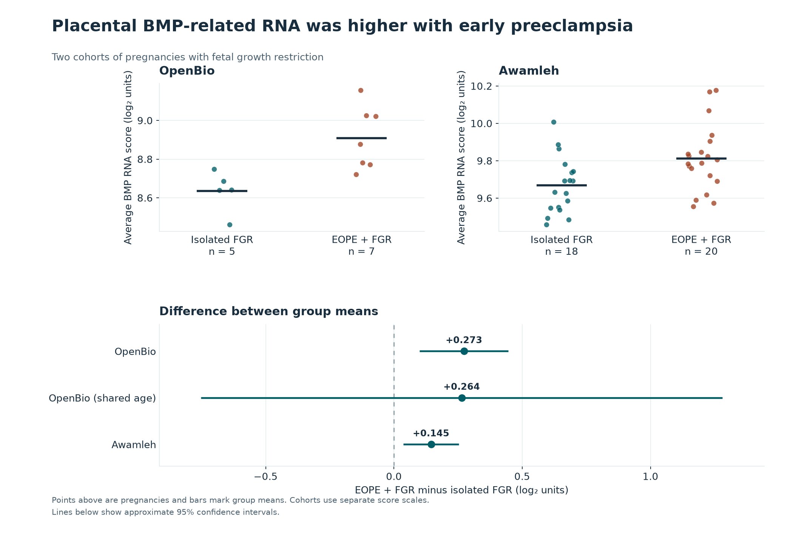
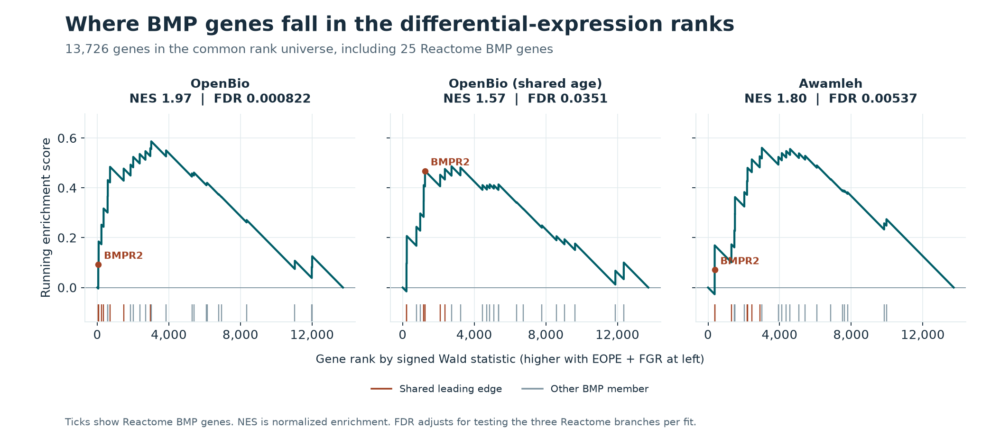
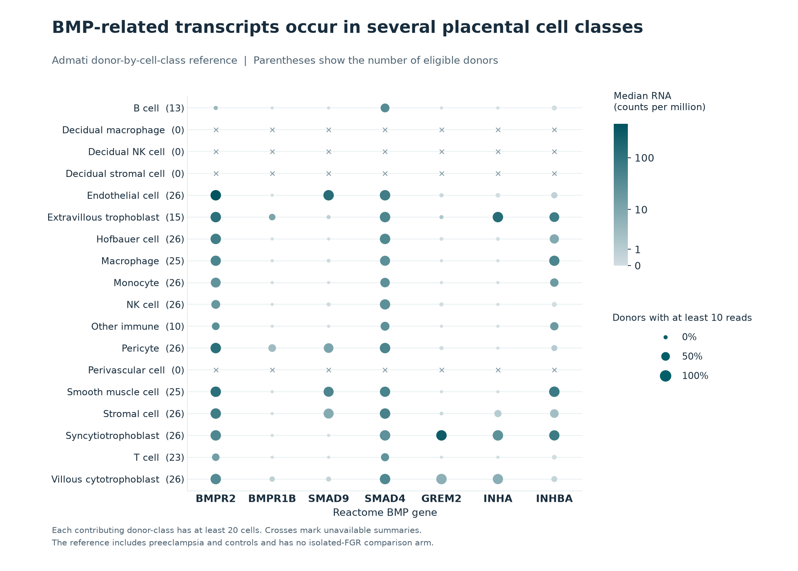
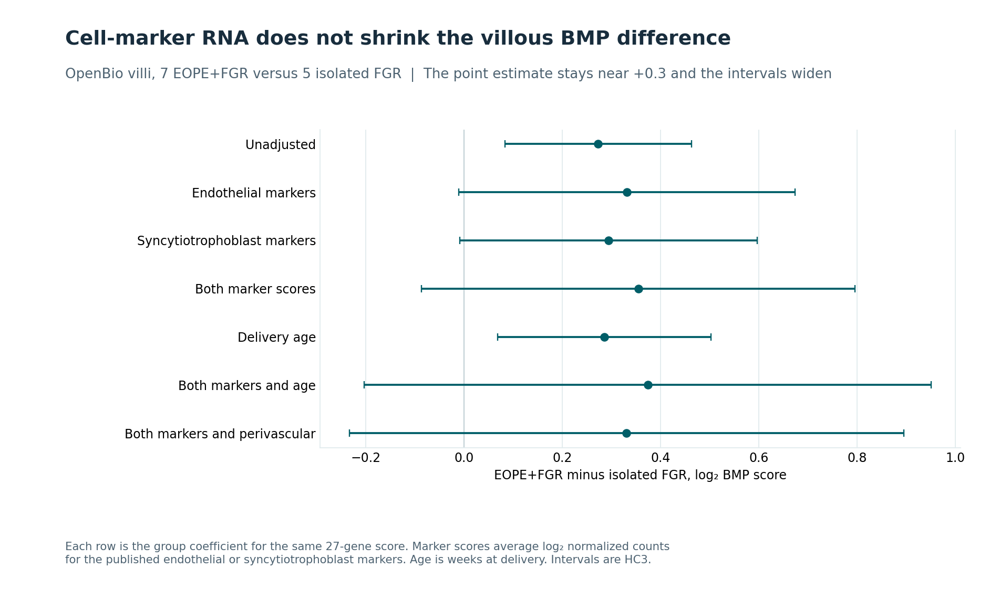

# A placental RNA pattern in early preeclampsia

**At delivery, a score based on RNA from 27 placental genes was higher when early preeclampsia accompanied restricted fetal growth.**

By Duc-Thanh Nguyen, Minh Dau, Radley Le

*Harvard Undergraduate OpenBio Datathon 2026, Track 1*

**Figure 1. Placental RNA scores by diagnosis.** Each dot in the upper panels represents one pregnancy and each bar shows its group’s average. The lower panel shows the difference between the groups within each study, with approximate 95% confidence intervals to show uncertainty. The vertical line marks zero difference.

## A comparison within pregnancies affected by growth restriction

The placenta supplies the developing fetus with oxygen and nutrients. In fetal growth restriction (FGR), the fetus grows less than expected. Some pregnancies with FGR also develop early-onset preeclampsia (EOPE), a high-blood-pressure disorder of pregnancy that starts before 34 weeks. We asked whether the placenta expresses a particular group of genes differently when both diagnoses occur. RNA levels show how much each gene is expressed at the time of sampling. We focused on genes involved in bone morphogenetic protein (BMP) signaling, a way that cells communicate. The gene set includes components that receive, pass along or block the signal, as well as two genes shared with a related pathway called activin. Ackerman and colleagues previously examined these clinical groups. We estimated the size and consistency of the RNA difference and asked whether markers of the likely source cells accounted for it. [Ackerman et al.](https://doi.org/10.1161/HYPERTENSIONAHA.122.20807) · [Reactome BMP signaling](https://reactome.org/content/detail/R-HSA-201451)

## Data and methods

We compared RNA from placental villi, the branches where the placenta exchanges oxygen and nutrients, collected at delivery. OpenBio and Awamleh supplied comparisons of early preeclampsia with growth restriction against growth restriction alone. Piekos supplied a comparison involving severe preeclampsia. Within each dataset we scaled counts for differences in sequencing depth, added one to each count and converted the result to a scale where each step represents a doubling. We averaged the values across 27 genes to give each pregnancy one score. OpenBio contributed 12 pregnancies to the main comparison, with limited overlap in delivery weeks. An exploratory look at OpenBio and Awamleh guided the choice of comparison. [Analysis plan](analysis-plan.md) · [OpenBio Track 1 data](https://github.com/Harvard-Undergraduate-OpenBio/openbio-datathon-2026/tree/fb751e91fb1eca4fb26a9658ad9d5042c382c4ba/track-01/data) · [Awamleh et al.](https://pmc.ncbi.nlm.nih.gov/articles/PMC6598374/) · [Piekos et al.](https://www.nature.com/articles/s42003-025-08631-6)

## The score was higher in both datasets

In OpenBio, the group with both diagnoses averaged **0.273 score units higher** than the group with FGR alone (7 versus 5 pregnancies, approximate 95% confidence interval 0.100 to 0.446). In Awamleh, the difference was **0.145** (20 versus 18, 0.037 to 0.253). Dropping any single pregnancy in either dataset kept the difference positive. The studies were scaled separately, so we compare groups within each study.

In Awamleh, the average was also higher in EOPE without growth restriction than in FGR alone (+0.168, interval 0.060 to 0.276). Pregnancies with FGR alone scored higher than preterm controls (+0.146, 0.047 to 0.244). Higher BMP-related RNA can accompany FGR alone and occurs across preeclampsia groups. Aisagbonhi and colleagues found changes in TGF-β signaling, a pathway related to BMP, in placentas from pregnancies with babies small for their gestational age, with and without preeclampsia. [Aisagbonhi et al.](https://pmc.ncbi.nlm.nih.gov/articles/PMC13098728/#S12)

## Few pregnancies with both diagnoses delivered in the shared weeks

In the full OpenBio comparison, the median delivery was 33 weeks in the group with both diagnoses and 29 weeks in the group with FGR alone. Across the 12 pregnancies, the BMP score and delivery week had a weak straight-line relationship (correlation coefficient 0.12, where zero indicates no straight-line relationship). A model that accounts for delivery week estimated a difference of **+0.286** (approximate 95% confidence interval 0.068 to 0.503). The model uses pregnancies outside the shared weeks and assumes the score changes at a constant rate with delivery week.

**Figure 2. Delivery weeks in the OpenBio comparison.** Each point represents one pregnancy. Triangles mark blood pressure flags in the source data. The shaded range, about 26.7–30.4 weeks, contains two pregnancies with both diagnoses and five with FGR alone.

The two pregnancies with both diagnoses in this range delivered at 27.0 and 27.7 weeks. The five with FGR alone had a median delivery of 29 weeks. The score difference in these seven pregnancies was +0.264, with a wide confidence interval from −0.752 to +1.281. The range of estimates compatible with the data includes no difference. The public Awamleh release provides diagnosis labels but no individual delivery weeks. [Awamleh et al.](https://pmc.ncbi.nlm.nih.gov/articles/PMC6598374/)

## A third cohort and the maternal-facing tissue agree on direction

In Piekos, the score was **+0.174** higher when severe preeclampsia accompanied FGR (interval 0.066 to 0.283, 25 versus 36 pregnancies). Inside that study’s shared delivery weeks, the estimate after accounting for delivery week was +0.110 (−0.069 to 0.289, 15 versus 17). The public data classify preeclampsia by severity and lack onset week. Only one pregnancy with FGR alone delivered before 34 weeks. [Piekos et al.](https://www.nature.com/articles/s42003-025-08631-6)

Nine OpenBio pregnancies had RNA from both villi and decidua, the maternal tissue where the placenta attaches. Four had both diagnoses and five had FGR alone. Three pregnancies with both diagnoses lacked decidual samples. Across the pregnancies with both samples, the score difference was **+0.415** (0.058 to 0.772) in decidua and +0.284 (−0.024 to 0.592) in villi. The difference between those estimates was +0.131 (−0.208 to 0.471), so it is unclear whether one tissue showed a larger difference.

## Individual BMP genes showed different patterns

We ranked genes by how strongly their RNA levels differed between groups. BMP genes clustered toward the higher-expression end of the ranking. The measure of that concentration, called the normalized enrichment score, was +1.97 in full OpenBio, +1.57 in the shared delivery weeks and +1.80 in Awamleh.

**Figure 3. Where BMP genes rank across the genome.** Ticks mark BMP genes. The line climbs as BMP genes accumulate in the ranked list. It peaks toward the left in all three panels, showing that BMP genes cluster among those with higher RNA levels when both diagnoses occur. The false discovery rate (FDR) values account for testing three pathways in each panel.

On the same scale as the pregnancy score, OpenBio **BMPR2**, which receives the signal, was +0.610 (0.054 to 1.167). **SMAD9**, which passes the signal along inside cells, was +0.668 (0.148 to 1.189). The receptor BMPR1B was +0.661 (−0.390 to 1.711), and the receptor BMPR1A was −0.142 (−0.410 to 0.127). The blocker **GREM2** was +0.838 (−0.136 to 1.812). SMAD1 and SMAD5, which also help pass along the signal, were lower on average with intervals that included zero. In the separate tests of individual genes across the genome, two BMP genes cleared the 5% false discovery rate threshold in Awamleh, BMPR2 and SMAD4. None cleared it in either OpenBio comparison.

The BMP list shares INHA and INHBA with activin. Removing these genes reduced the differences from +0.273 to +0.171 in OpenBio and from +0.145 to +0.085 in Awamleh. The Awamleh interval then included zero. Genes from activin and another related signaling pathway also shifted in the full datasets. The pattern fits an RNA response across the broader family of signals that includes BMP. [Reactome BMP signaling](https://reactome.org/content/detail/R-HSA-201451)

## Accounting for cell markers left a similar score difference

In a placental cell reference from Admati and colleagues, BMPR2 and SMAD9 were most abundant in endothelial cells, which line blood vessels. GREM2 was most abundant in syncytiotrophoblast, the cell layer in contact with maternal blood. BMPR1B was detected infrequently and occurred most prominently in extravillous trophoblast, cells that extend into maternal tissue. The reference includes pregnancies with preeclampsia and controls. The cell types that changed within the pregnancies in our main comparison remain unknown. [Admati et al.](https://doi.org/10.1016/j.medj.2023.07.005) · [Zeisel lab browser](https://zeisellab.org/preeclampsia/)

**Figure 4. Which placental cells express the genes?** Darker dots mark higher median RNA levels. Larger dots mark genes that reached at least 10 RNA reads in a larger share of donors. Crosses mark unavailable summaries. We made the figure from the Admati data. [Source data](https://doi.org/10.1016/j.medj.2023.07.005)

We used genes typical of the two cell types as markers. On the same scale as the BMP score, we averaged PECAM1, VWF, CDH5 and CLDN5 for endothelium, and CGA, ERVW-1 and PSG1 for syncytiotrophoblast. In the OpenBio comparison of seven versus five pregnancies, the endothelial marker score was **+0.242** higher (0.032 to 0.452). The syncytiotrophoblast marker score was +0.319 (−0.279 to 0.917). The BMP score correlated weakly with both (0.28 and 0.10). Accounting for the endothelial marker score, the syncytiotrophoblast marker score, or both gave BMP differences of **+0.332, +0.294 and +0.355**, respectively. The estimates stayed near the unadjusted +0.273, with wider intervals that included zero.

**Figure 5. BMP score differences after accounting for cell markers and delivery week.** Each dot compares the same seven pregnancies with both diagnoses and five with FGR alone. Lines show approximate 95% confidence intervals. Estimates stay positive when the models account for cell markers, and the intervals reach across zero.

The markers changed some individual estimates. SMAD9 correlated with the endothelial score (0.64), and its group difference fell from +0.668 to +0.424 after we accounted for that score, with an interval from −0.265 to 1.112. BMPR2 correlated weakly with the endothelial score (0.15), and its estimated difference was +0.843 (0.015 to 1.672) after the same adjustment. GREM2 correlated with the syncytiotrophoblast score (0.65), and its interval included zero before and after adjustment. A marker can rise because the tissue contains more of a given cell type, because each cell makes more of the marker or both. Counting cells on tissue sections would help separate those possibilities.

## Unanswered questions

Delivery week, labor, delivery mode, FGR severity and cell proportions could account for part of the score difference. The linked activin genes explain part of the difference, and the RNA measurements came from mixed tissue at a single time, delivery. We cannot tell when the RNA difference developed or whether it contributed to either condition. RNA levels also leave open how active the BMP pathway was inside those cells.

## Conclusion and next steps

The score difference at delivery pointed in the same direction in all three studies. The comparisons at similar delivery ages were imprecise, and the Awamleh data helped choose the question. We hypothesize that some of the difference reflects changes within cells, including higher BMPR2 RNA in the cells lining placental blood vessels. A new study of the two growth-restriction groups with overlapping delivery weeks could count endothelial and syncytiotrophoblast cells and measure BMPR2 and GREM2 RNA in those cells. If measured cell proportions account for the tissue score difference, that would weaken the explanation based on changes within cells. Measuring a chemically modified form of the SMAD1, SMAD5 and SMAD9 proteins in cell nuclei, called phosphorylated SMAD1/5/9, would test pathway activity separately. [Hypothesis card](hypothesis-card.md) · [Yi et al.](https://doi.org/10.3389/fcell.2021.768669) · [Deng et al.](https://doi.org/10.1016/j.ebiom.2023.104664)

## Data and code

- The project repository includes instructions for rebuilding the cohort figures, source tables and marker RNA analysis. [Project repository](https://github.com/thanhnguyen112358/OpenBio) · [Submission README](../README.md) · [Main workflow](../notebooks/run.py) · [Cell marker analysis](../notebooks/composition.py)
- Ackerman and colleagues supplied the tissue counts and clinical data, and Admati and colleagues supplied the cell reference curated by OpenBio. [OpenBio Track 1 files](https://github.com/Harvard-Undergraduate-OpenBio/openbio-datathon-2026/tree/fb751e91fb1eca4fb26a9658ad9d5042c382c4ba/track-01/data) · [Ackerman dataset](https://www.ncbi.nlm.nih.gov/geo/query/acc.cgi?acc=GSE203507) · [Admati dataset and study](https://doi.org/10.1016/j.medj.2023.07.005)
- The Awamleh comparison uses public RNA counts and diagnoses, with a reference gene annotation to combine transcript counts by gene. The severe preeclampsia comparison uses the Piekos release. [Awamleh dataset](https://www.ncbi.nlm.nih.gov/geo/query/acc.cgi?acc=GSE114691) · [Ensembl reference](https://ftp.ensembl.org/pub/release-75/gtf/homo_sapiens/) · [Piekos data and code](https://github.com/spiekos/Hood-Lab-Placental-Multiomics)
- Pathway gene lists came from Reactome via the Molecular Signatures Database. [Reactome BMP pathway](https://reactome.org/content/detail/R-HSA-201451) · [MSigDB release](https://data.broadinstitute.org/gsea-msigdb/msigdb/release/2024.1.Hs/)

## Acknowledgements

We thank the participants in the contributing studies, the study teams for sharing their data and the Harvard Undergraduate OpenBio organizers for curating the datathon datasets and materials.
