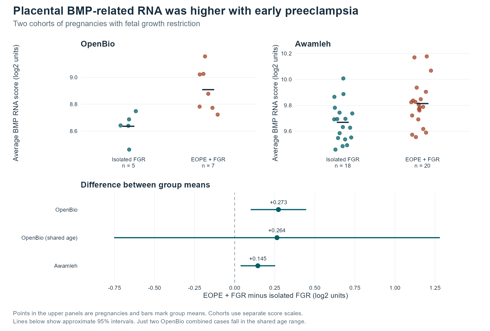
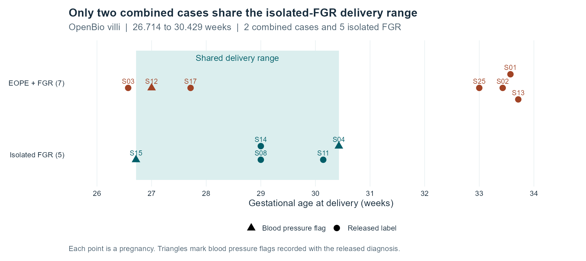
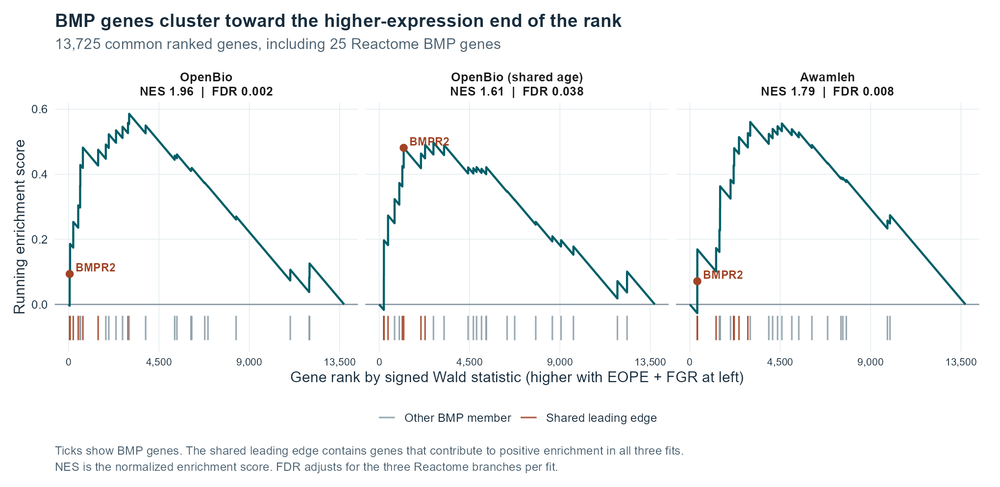
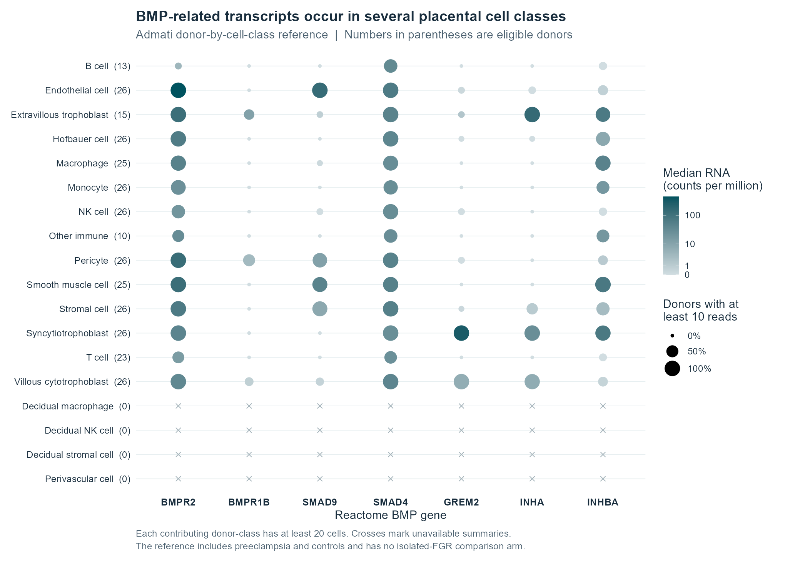

# Placental RNA when preeclampsia and growth restriction occur together

Across two datasets, placentas from the combined group had higher RNA levels for genes involved in BMP signaling. Delivery timing and the types of cells in each sample may explain part of the difference.

*Harvard Undergraduate OpenBio Datathon 2026, Track 1*

## A comparison within pregnancies affected by growth restriction

The placenta supplies the developing fetus with oxygen and nutrients. In fetal growth restriction (FGR), the fetus grows less than expected. Some pregnancies with FGR also develop early-onset preeclampsia (EOPE), a high-blood-pressure disorder of pregnancy that starts before 34 weeks. We asked whether the chorionic villi, the part of the placenta involved in exchange between mother and fetus, show an additional shift in RNA when both diagnoses occur. We focused on genes associated with bone morphogenetic protein (BMP) signaling, a family of signals involved in blood vessel and placental cell biology. Ackerman and colleagues previously examined the same clinical groups. Our analysis measures the size and consistency of a specific BMP-associated RNA difference. [Ackerman et al.](https://doi.org/10.1161/HYPERTENSIONAHA.122.20807) · [Reactome BMP signaling](https://reactome.org/content/detail/R-HSA-201451)

## Data and methods

We used villous RNA counts collected at delivery from the OpenBio release of Ackerman’s study and from a separate study by Awamleh and colleagues. After scaling counts for differences among sequencing libraries within each cohort, we averaged the base-2 log expression of 27 curated BMP genes to give every pregnancy one RNA score. We used separate gene-level models to check where BMP genes fell among the biggest changes. A pilot analysis that included both cohorts guided the choice of this comparison. [Analysis plan](analysis-plan.md) · [OpenBio Track 1 data](https://github.com/Harvard-Undergraduate-OpenBio/openbio-datathon-2026/tree/fb751e91fb1eca4fb26a9658ad9d5042c382c4ba/track-01/data) · [Awamleh et al.](https://pmc.ncbi.nlm.nih.gov/articles/PMC6598374/)

## Both cohorts showed higher BMP-related RNA with early preeclampsia

Each dot in the top panels represents one pregnancy, and each bar marks its group’s average. Normalization gives the cohorts separate score scales, so the comparisons are between groups within each study. In OpenBio, the combined group averaged **0.273 log₂ score units higher** than isolated FGR (7 versus 5 pregnancies, approximate 95% confidence interval 0.100 to 0.446). In Awamleh, the difference was **0.145** (20 versus 18, 0.037 to 0.253). The lines indicate the uncertainty around each estimated difference. Dropping any single pregnancy in either cohort kept the difference positive.

In Awamleh, the average was also higher in EOPE without growth restriction than in isolated FGR (+0.168, interval 0.060 to 0.276). Isolated FGR scored higher than preterm controls (+0.146, 0.047 to 0.244). These comparisons suggest that elevated BMP-related RNA can accompany FGR alone and occur across preeclampsia groups. Aisagbonhi and colleagues also saw changes in the broader TGF-β family in small-for-gestational-age placentas with and without preeclampsia, each compared with a normotensive group with normal-size babies. [Aisagbonhi et al.](https://pmc.ncbi.nlm.nih.gov/articles/PMC13098728/#S12)

## Delivery timing limits the comparison

In the full OpenBio comparison, the median delivery was 33 weeks in the combined group and 29 weeks in isolated FGR. The shaded band shows the shared observed range, about 26.7–30.4 weeks. Within it, the two combined cases delivered at 27.0 and 27.7 weeks and the five isolated-FGR pregnancies had a median of 29 weeks. The score difference remained positive (+0.264), with an interval spanning −0.752 to +1.281. The data leave room for a wide range of effects at comparable delivery ages. Keeping or excluding the two isolated-FGR pregnancies with blood pressure flags gave positive estimates. The public Awamleh release records diagnosis per pregnancy and does not provide individual delivery ages. We used all released Awamleh samples, while the original study used a smaller set after quality checks and modeled additional covariates. [Awamleh et al.](https://pmc.ncbi.nlm.nih.gov/articles/PMC6598374/)

## The difference involved receptors and regulators

The plot ranks genes from those most strongly higher with EOPE+FGR at the left to those most strongly lower at the right. Each tick is a BMP gene. A positive curve means BMP genes tended to cluster on the higher-expression side. The normalized enrichment scores were +1.96, +1.61 and +1.79 for full OpenBio, shared-age OpenBio and Awamleh, respectively. Recurrent contributors included **BMPR2** and **BMPR1B**, which encode BMP receptors, and **GREM2**, which encodes a protein that can block BMP signals. BMPR2 RNA was higher by an estimated 0.55 log₂ fold-change units in full OpenBio and 0.29 in Awamleh. Only the Awamleh BMPR2 result passed the gene-level 5% false discovery threshold, which accounts for the many genes tested.

The BMP list includes genes shared with activin, another TGF-β family pathway. Removing INHA and INHBA reduced the full-cohort differences from +0.273 to +0.171 in OpenBio and from +0.145 to +0.085 in Awamleh. The latter interval crossed zero. Related pathways also showed shifts in the full-cohort rank analyses. The combined pattern is compatible with a broader TGF-β family response. [Reactome BMP signaling](https://reactome.org/content/detail/R-HSA-201451)

## Several cell populations could contribute

In the Admati placental reference, darker dots show a higher median RNA level in a cell class and larger dots show that more donors had at least ten reads for that gene. Cell classes needed at least three donors each with at least 20 sampled cells. BMPR2 and the signaling mediator SMAD9 were most abundant in endothelial cells, which line blood vessels. GREM2 was most abundant in syncytiotrophoblast, the cell layer in contact with maternal blood. BMPR1B RNA was sparse and most prominent in extravillous trophoblast in this reference. The browser displayed BMPR2, GREM2 and SMAD9. It had no BMPR1B panel, so we used the released donor-class table for that gene. Vascular and syncytiotrophoblast markers tended to be higher in the bulk comparison in both cohorts. That pattern could reflect changes in the proportion of cells, changes in RNA within cells, or both. The reference does not include an isolated-FGR comparison group. [Admati et al.](https://doi.org/10.1016/j.medj.2023.07.005) · [Zeisel lab browser](https://zeisellab.org/preeclampsia/)

## The next measurement is signaling inside cells

The two cohorts show higher BMP-associated RNA at delivery when EOPE accompanies FGR. Delivery age, FGR severity, labor, delivery mode, placental sampling and cell composition could account for part of the difference. To learn whether BMP signaling changes within cells, a new study could collect the two FGR groups at comparable delivery ages, count the cell types in each section and measure the activated signaling proteins inside the nuclei of endothelial cells and trophoblasts. A higher RNA score with similar signaling within each cell type would point toward changes in tissue composition or other regulation. [Hypothesis card](hypothesis-card.md) · [Yi et al.](https://doi.org/10.3389/fcell.2021.768669) · [Deng et al.](https://doi.org/10.1016/j.ebiom.2023.104664)

## Data and code

The [project README](../README.md) links to all data releases. The [analysis code](../notebooks/run.py) rebuilds the figures and source tables. We thank the participants in the contributing studies and the teams who released and organized the datasets.
