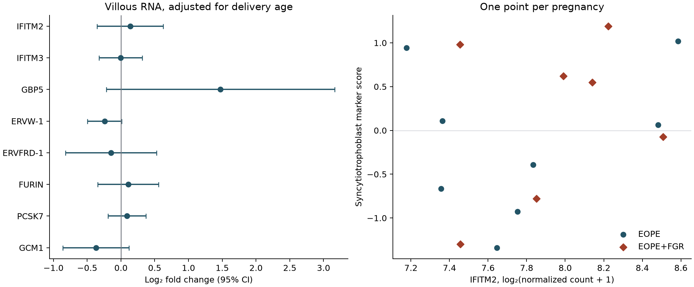

# Does trophoblast fusion restriction differ across early placental insufficiency phenotypes?

**Primary clinical contrast** · Early-onset preeclampsia with fetal growth restriction (EOPE+FGR) minus EOPE without FGR.

**Primary RNA endpoint** · The difference in villous `IFITM2` expression at delivery, reported as an age-adjusted log₂ fold change. The sign is open because the clinical premise predicts heterogeneity without specifying which group has higher expression. In a secondary directional test, higher `IFITM2` should accompany lower villous trophoblast maturation after accounting for clinical group and broad interferon-response transcription.

**Scope** · The aim is to adjudicate a specific RNA association, identify its cellular source, and determine whether an observed phenotype is consistent with a fusion mechanism. Delivery RNA establishes associations at a single time point. Even direct fusion measurements on cells collected at delivery establish function in those samples. A claim about disease initiation requires earlier evidence.

## What the pilot found

**The data weaken the proposed phenotype-specific bulk IFITM2 difference.** The OpenBio estimate was small and changed sign with age or inferred-round restrictions. The larger external cohort estimated a near-zero difference with greater precision. The trophoblast-specific RNA and fusion hypotheses remain open. There is currently insufficient evidence to advance the within-EOPE IFITM2–FGR contrast to functional validation as the lead observation.

| IFITM2 comparison | Combined vs. EOPE alone | Estimate [95% interval] |
| --- | --- | --- |
| Ackerman villous bulk, delivery-age-adjusted count model | 7 vs. 8 | +0.14 [−0.35, +0.63] log₂ fold change |
| Ackerman bulk, delivery-age overlap | 4 vs. 7 | −0.07 [−0.75, +0.60] log-normalized difference |
| Ackerman bulk, inferred same sequencing round | 7 vs. 4 | −0.05 [−0.99, +0.88] log-normalized difference |
| Awamleh villous bulk, unadjusted count model | 20 vs. 20 | −0.06 [−0.27, +0.15] log₂ fold change |
| Admati villous cytotrophoblast, unadjusted count model | 6 vs. 4 | −0.28 [−1.12, +0.56] log₂ fold change |
| Admati villous cytotrophoblast, delivery-age-adjusted count model | 6 vs. 4 | −0.39 [−1.27, +0.49] log₂ fold change |

- **Clinical contrast.** The OpenBio age-adjusted log-normalized estimate remained positive when omitting one donor at a time, ranging from +0.06 to +0.29. Its sign reversed when restricting the comparison to delivery-age overlap or the inferred shared round. This makes cohort comparability a larger concern than a single influential donor. The external result and all five IFITM2 transcript-level checks point to a small average difference. Its interval lies inside the provisional ±0.50 band for the unadjusted contrast. Sample-level age, labor, mode of delivery and batch are unavailable in the GEO release. The publication reports mRNA exclusions without public sample IDs. The replication used all 40 released case donors. The cohorts could share altered IFITM2 relative to unaffected pregnancies even with little difference from each other.
- **Context across all five groups.** The tissue-wide normalized IFITM2 medians on the `log₂(count + 1)` scale were 7.99 for EOPE+FGR, 7.70 for EOPE alone, 7.79 for isolated FGR, 7.78 for iPTB and 7.90 at term. Donor ranges overlap across all five groups. The wider age and delivery-context differences make these distributions descriptive. Similar medians in FGR and iPTB leave shared stress, disease-specific effects and a weak bulk signal as plausible explanations.
- **Differentiation.** The bulk standardized IFITM2 slope for the STB marker score was +0.25 [−0.57, +1.08] after conditioning on group and age, and +0.28 [−0.63, +1.19] with the fixed IFN score. The point estimates go against the predicted inverse marker relationship. GCM1 had a weak inverse estimate in bulk (−0.18 [−0.65, +0.28]) and in VCT (−0.29 [−1.30, +0.72]). The VCT slope changed sign under donor deletion. These discordant and imprecise readouts fit the possibility that endocrine/abundance markers and a differentiation regulator report different features of the tissue. A common IFITM2-dependent maturation defect remains unresolved. The short IFN, hypoxia and myeloid panels also showed little consistent group separation, with wide intervals.
- **Localization.** Admati STB gave +0.63 [−0.55, +1.81], while its alternative log-normalized age-adjusted and shared-window estimates were negative. IFITM2 counts were particularly sparse in EOPE-only STB. Macrophage (+0.29 [−0.46, +1.04]) and Hofbauer (−0.06 [−0.55, +0.44]) estimates were also imprecise, leaving an immune-dominant difference unresolved. In the 12 complete Ackerman pairs, the difference of IFITM2 group effects between villi and decidua was −0.53 [−1.29, +0.23] on the log-normalized scale. The point estimate favored a larger change in decidua, but both compartment estimates were imprecise and the pair set omits three combined pregnancies. This supplies little support for villous enrichment.
- **GBP5 and syncytins.** OpenBio GBP5 was +1.47 [−0.22, +3.16] and syncytin-1 `ERVW-1` was −0.24 [−0.50, +0.01]. As a pattern these could motivate a processing hypothesis, but neither is a precise secondary effect. External GBP5 was −0.02 [−0.57, +0.53] and trophoblast pseudobulk GBP5 was below the count-model filter. The nominal macrophage GBP5 estimate was negative and became inconclusive on the log-normalized scale. IFITM3 bulk effects were near zero in both cohorts. Stable FURIN or PCSK7 RNA cannot adjudicate differences in processing. Keep GBP5 as a separate branch that would need protein localization and cleavage evidence before attributing a fusion defect to it.

[OpenBio gene effects](../../../Trophoblast_Fusion/results/villous_deseq2_panel.csv) · [Sensitivity and paired checks](../../../Trophoblast_Fusion/results/delivery_rna_sensitivity.csv) · [Admati pseudobulk results](../../../Trophoblast_Fusion/results/pseudobulk_count_models.csv) · [VCT differentiation check](../../../Trophoblast_Fusion/results/pseudobulk_vct_ifitm2_gcm1.csv) · [External replication](../../../Trophoblast_Fusion/results/awamleh_panel.csv)



## What the study could add

Prior work already shows that IFITM proteins can reduce trophoblast fusion in experimental models, that IFITM2 is elevated in the syncytiotrophoblast layer in a small hypertensive-disorder study, and that primary cytotrophoblasts isolated from FGR placentas can show reduced fusion. The opportunity is to link a particular restriction factor to a reproducible **early clinical subgroup**, a **defined villous trophoblast population** and **direct fusion behavior** in the same pregnancies. GBP5 belongs in a separate branch with a syncytin-1 processing prediction. The 2025 study's clinical GBP5 comparison was statistically inconclusive. It demonstrated PCSK7 activity on a syncytin-2 cleavage-site substrate and noted uncertainty about efficient cleavage of full-length syncytin-2. [Buchrieser et al.](https://pubmed.ncbi.nlm.nih.gov/31296770/) · [Yoshida et al.](https://pmc.ncbi.nlm.nih.gov/articles/PMC13264021/) · [Ruebner et al.](https://pubmed.ncbi.nlm.nih.gov/20664994/) · [Krchlikova et al.](https://pmc.ncbi.nlm.nih.gov/articles/PMC12057675/)

| Claim | Primary readout | Observation that would weaken it |
| --- | --- | --- |
| FGR within EOPE is associated with a material difference in villous IFITM2 RNA | EOPE+FGR minus EOPE-only log₂ fold change, with delivery-age and batch sensitivity | A sufficiently precise interval within the prespecified range of negligible effects in an adequately measured independent cohort |
| The association involves villous trophoblast | Same contrast in donor-level VCT profiles, followed by layer-resolved RNA/protein in independent tissue | Reproducible immune-only localization with adequate measurement in VCT and syncytiotrophoblast (STB) |
| Restriction is linked to altered differentiation or fusion | Conditional differentiation slope, then direct trophoblast fusion with viability and protein measurements | Precise comparable fusion between groups despite a verified, meaningful difference in trophoblast restriction protein. Weak RNA marker associations specifically weaken the RNA prediction |

### Decision thresholds

Use ±0.50 log₂ fold change (about a 1.41-fold difference) as a **provisional planning threshold** for bulk IFITM2. It is an investigator choice for this pilot and has no established clinical significance. Revisit it against assay repeatability and biological relevance before locking an independent confirmatory test. Report two-sided 95% intervals. An interval inside a prospectively defined equivalence range supports practical equivalence under that design. An interval spanning material values and zero is unresolved. A point estimate above the threshold helps prioritize follow-up only when donor sensitivity, design support and independent validation are compatible. Use a separately justified minimum effect for protein and direct fusion. Size a validation study for those effects or for a target interval width, accounting for donor variability, imbalance, batch and tissue attrition. Set those criteria using prior assay data or a separate pilot. The small phenotypic strata here are unsuitable for calibrating a clinical classifier.

## Phase 1 · Freeze inputs and verify what each cohort can estimate

| Input | Relevant comparison | Limitation to carry forward |
| --- | --- | --- |
| Ackerman villi, GSE203507 | 7 EOPE+FGR, 8 EOPE-only, 5 isolated early FGR, 5 spontaneous idiopathic preterm births (iPTB), 5 term births | Within EOPE, delivery-age overlap keeps 4 combined and 7 EOPE-only at 26.571–33.000 weeks. The inferred same sequencing round has 7 and 4. Its strict shared age window keeps 2 and 4 at 27.714–33.000 weeks. Isolated FGR versus iPTB has only 2 and 1 in age overlap. Term describes a different gestational window. |
| Ackerman paired decidua basalis | 27 complete pairs overall, including 4 combined and 8 EOPE-only | The three absent decidua libraries are all from combined disease. Pair estimates describe the complete-pair subset. |
| Admati donor pseudobulk | 6 early PE+FGR and 4 early PE without FGR in VCT and STB at ≥20 captured cells per profile. Shared delivery-age support retains 4 and 3 | Three other early donors are non-PE controls and delivered vaginally. There is no isolated FGR arm. The organizer merges annotated substates within each class, including IFN-associated VCT. |
| Awamleh placental RNA, GSE114691 | 20 early PE+FGR, 20 early PE, 18 early FGR, 21 preterm-labor comparators | Verify GSM-to-column matches, tissue and gene build. Public counts can support an unadjusted contrast. Adjustment requires accessible sample-level clinical covariates. |
| Nonn nuclei and Sánchez-Corrales nuclei/spatial | STB nuclear-state context or localization of combined early disease versus a preterm comparator | Nonn includes term and early pregnancy references with an external preterm comparison. Sánchez-Corrales early severe PE deliveries below 34 weeks are all growth restricted in Table 1. Neither design reproduces the within-EOPE contrast. Standard Visium spots can mix cell types. |

[Ackerman paper and supplements](https://pmc.ncbi.nlm.nih.gov/articles/PMC10192030/) · [Organizer data dictionary](../../../openbio-datathon-2026/track-01/data/track01_data_dictionary.md) · [Round audit](../../../Deci_Vili_H1/results/step01_cohort_audit/README.md) · [Admati et al.](https://pubmed.ncbi.nlm.nih.gov/37572658/) · [Awamleh GSE114691](https://www.ncbi.nlm.nih.gov/geo/query/acc.cgi?acc=GSE114691) · [Nonn GSE183338](https://www.ncbi.nlm.nih.gov/geo/query/acc.cgi?acc=GSE183338) · [Sánchez-Corrales GSE319236](https://www.ncbi.nlm.nih.gov/geo/query/acc.cgi?acc=GSE319236)

1. Record source accession, repository revision, table filenames and file checksums. Match metadata and counts by IDs, confirm one donor per bulk sample within tissue, and verify sample alignment, integer counts, unique gene features, and reported HTSeq assignment counts. Keep clinical groups as released. Read weeks-and-days fields using the converted decimal-week column. Flag discordant BP or FGR-related fields for sensitivity analyses with their source labels intact. Record PE onset separately from delivery age, and use clinical FGR criteria and Doppler if available.
2. Plot delivery ages, counts by group and round, sequencing depth, and assignment fractions before fitting. Tabulate delivery indication, labor, delivery mode, fetal sex and any recorded antenatal exposures. For the Ackerman release, sample-level round is partly inferred, and delivery mode and labor are absent from the released table. Label the round assignments as inferred and document missing delivery variables. Delivery age can itself be downstream of disease. The full age-adjusted model estimates a conditional delivery-time association and assumes a common age slope across groups. Overlap restriction changes which pregnancies it describes.
3. Map the fixed panel using stable HGNC/Ensembl IDs and check source aliases such as `ERVW-1` and `ERVFRD-1`. Check paralog specificity for IFITM2/3 and the CGB family. Inspect zero counts and depth by donor and arm and distinguish absent annotation from low coverage. Frozen features with weak coverage stay documented as unevaluable. Keep eligible donors across the full observed outcome range.

**Output** · A sample flow, overlap/QC plots, ID and annotation map, and a per-gene detection table. If phenotype is fully confounded with batch or there is no shared support for a restricted contrast, describe its observed distributions and take the comparison to a different cohort.

## Phase 2 · Test the primary villous RNA contrast

1. Fit a donor-level negative-binomial model in the 15 EOPE pregnancies using raw counts and size factors. Specify `~ centered_delivery_age + group`, with EOPE alone as the reference. The pilot fits dispersion across genes with ≥10 raw counts in at least three samples. Report the unshrunk IFITM2 log₂ fold change, 95% Wald interval, and nominal p-value for the single primary endpoint. Carry `IFITM3`, `GBP5`, `ERVW-1`, `ERVFRD-1`, `FURIN`, `PCSK7` and `GCM1` as a fixed secondary panel, reporting BH-adjusted q-values for that secondary panel. Record convergence, Cook's diagnostics, and candidate coverage.
2. Plot each pregnancy by delivery age and group. Use the same fixed, tissue-wide median-ratio normalization for donor displays and rapid checks. Compare the age-adjusted point estimate with unadjusted 7-vs.-8, overlap 4-vs.-7, same-round 7-vs.-4, and strict 2-vs.-4 summaries. The executable uses log₂-normalized counts and HC3 intervals for these checks, so the count and sensitivity models work on related but different scales. Use leave-one-donor-out estimates to locate fragile shifts. Check any depth or clinical flags explicitly. Once the sequencing batch is confirmed, fit `~ centered_delivery_age + round + group` if rank and overlap support it and state which round identifies the clinical contrast.
3. Show isolated FGR and iPTB as context in this release. To distinguish shared FGR from a combined-disease signal, use the directly estimated contrasts `(EOPE+FGR) − EOPE` and `FGR − iPTB` in a cohort with age overlap. Estimate their difference in a single model if the data support the resulting interaction. Treat a term comparison as developmental context.

**Output** · One age-overlap panel, an effect-size forest, donor plots, and a table carrying the exact analysis population and uncertainty for every estimate.

## Phase 3 · Test specificity and challenge the differentiation interpretation

1. The local pilot uses an STB-enriched marker score with `CGA`, `PSG1`, `SDC1` and `CSH1`. Score each as its within-cohort z-score of log₂ normalized expression and take the equal-weight mean. Assess `GCM1` separately. In bulk, this marker score can track the amount of STB material, endocrine state or subtype composition. For stronger follow-up, derive mature-versus-nascent STB nuclear signatures from an age-relevant reference, using donor-level estimates and validating them independently. Freeze sign, weights and membership before testing the clinical fit. Keep genes for distinct mature STB subtypes separate if they diverge, and exclude IFN genes, restriction genes and direct endpoints from the differentiation score. [Track 1 marker guide](../../../openbio-datathon-2026/track-01/data/interpretation/zeisel_browser_guide.md) · [Wang et al.](https://www.nature.com/articles/s41588-023-01647-w) · [GCM1 lineage study](https://pmc.ncbi.nlm.nih.gov/articles/PMC9894182/)
2. Fit `z(STB marker score) ~ z(IFITM2) + group + delivery_age` and repeat with `z(GCM1)` as supporting evidence. Inspect both groups in the donor scatter. The pilot uses a fixed disjoint 15-gene interferon response panel listed in the script, and adds it to the model as a separate check. The confirmatory workflow uses a versioned Hallmark IFN-α/IFN-γ union with candidate and maturation genes removed, then α and γ separately for sensitivity. Report score coverage and correlations before using either as a covariate. A persistence estimate is conditional on measured IFN transcription. IFN could lie upstream or share drivers with the phenotype, so attenuation can be compatible with biologic involvement.
3. For the attachment's comparative claim, compare the model with the IFN score alone to the nested model that adds IFITM2, keeping group and age fixed. In a larger cohort report incremental partial R², slope and interval, and compare held-out error for the equally sized IFN-versus-IFITM2 models as well. In this 15-donor pilot use signed coefficients and intervals; the short score is a sensitivity analysis. [MSigDB Hallmark collection](https://www.gsea-msigdb.org/gsea/msigdb/human/collections.jsp#H)
4. Add hypoxia and myeloid scores in separate sensitivity fits. The pilot uses `LDHA`, `PDK1`, `SLC2A1`, `EGLN3`, `ALDOA`, `BNIP3` and `CD68`, `LST1`, `CSF1R`, respectively. The myeloid score reflects expression and may vary with activation. In a richer study, compare with independent deconvolution or histology and quantify STB abundance, trophoblast turnover and senescence. Check collinearity, and report parallel unconditioned and conditioned estimates. Hypoxia can independently reduce GCM1, syncytin expression and fusion. STB also contains heterogeneous nuclear populations that change with age and disease. [Wich et al.](https://pubmed.ncbi.nlm.nih.gov/19321927/) · [Campbell et al.](https://doi.org/10.1038/s42003-023-04623-6) · [Nonn et al.](https://pmc.ncbi.nlm.nih.gov/articles/PMC12002046/)

**Output** · Donor-level score components and scatterplots, conditional slopes with intervals, and a comparison of grouping, hypoxia and cell-mixture explanations.

## Phase 4 · Test cell and tissue localization

1. In Admati, aggregate or use the released raw donor-by-cell-class counts. VCT is the primary class because IFITM2 reaches 10 counts in 6/6 combined and 3/4 EOPE-only donor profiles. In STB it reaches that count in 5/6 and 1/4. Macrophages and Hofbauer cells are biologically informative comparators. Use ≥20 captured cells per class and donor as the pilot minimum and ≥10 as a sensitivity check. Keep donor as the unit even when several libraries contributed. Analyze classes individually, showing raw counts, library sizes, capture balance, ages and the class-level effect with uncertainty. Use tissue-matched, age-overlap and delivery-context checks when estimable. The Admati shared-age case-only comparison contains 4 and 3 pregnancies.
2. A broad VCT signal could reflect shifts in IFN-associated or differentiating VCT substates. If a signal becomes credible, revisit original labels, cell-level QC and ambient RNA before calling within-state regulation. Compare subtype proportions and within-subtype donor effects. Treat STB dissociation and low reads as measurement limitations. GBP5 reaches 10 counts in zero early VCT/STB profiles and in 12/12 eligible macrophage profiles, so the release informs macrophage expression better than trophoblast GBP5. [Admati data](https://figshare.com/articles/dataset/Placenta_PE_single_cell_RNAseq_dataset_Admati_Skarbianskis_et_al_/23264102) · [Cell-class map](../../../openbio-datathon-2026/track-01/data/extension/pseudobulk/track01_cell_class_map.csv) · [STB nuclei atlas](https://www.nature.com/articles/s41588-023-01647-w)
3. In the 12 complete pairs for the clinical contrast, compare the change in villi versus paired decidua basalis using donor-level differences or the group-by-tissue interaction. The pilot uses the difference of log₂-normalized IFITM2 in the two tissues and regresses it on group and delivery age. Analyze the same complete-pair subset in villi to see how the missing pairs change the estimate. A larger villous difference supports compartment enrichment. A similar change in both tissues flags a broader delivery-time pattern. Decidua basalis can include fetal cells, and an interaction supplies no direction of signaling.

**Output** · Donor-by-class coverage and effect tables plus a paired-tissue interaction estimate. Compare classes by donor support, effect sizes and coverage.

## Phase 5 · Replicate without reselecting endpoints

1. Use the fixed within-EOPE comparison in GSE114691. Record a one-to-one join between RNA-seq GSMs and column names. Resolve the submitted transcript IDs against the appropriate GRCh37 Ensembl release and report unmapped or ambiguous features. Aggregate transcripts only when their counting semantics support aggregation, and confirm the lead direction on well-assigned high-coverage transcripts or independently quantified gene counts. Check delivery-age, labor and batch at sample level before upgrading an unadjusted result to a matched replication. Compare cohort estimates and their intervals before any meta-analysis. Both studies use clinically selected preterm comparator groups. [Awamleh et al.](https://doi.org/10.1186/s12920-019-0548-x) · [GSE114691 counts and metadata](https://www.ncbi.nlm.nih.gov/geo/query/acc.cgi?acc=GSE114691)
2. If localization remains the question, use Nonn for villous STB nuclear-state context and Sánchez-Corrales for combined disease versus age-matched preterm cesarean comparators. In spatial villi use defined villous regions, record histology and aggregate by pregnancy. For subtype-resolved inference require a comparable, adequately sampled disease stratum and verified unique candidate detection. The published Sánchez-Corrales villous spatial dataset is spot-level. Tissue region annotation and cell-source assignment remain distinct. [Nonn et al.](https://pmc.ncbi.nlm.nih.gov/articles/PMC12002046/) · [Sánchez-Corrales et al.](https://doi.org/10.1126/sciadv.aed8964) · [Processed spatial and single-cell data](https://doi.org/10.6084/m9.figshare.31489183.v2)

**Output** · A cohort-comparability table and a common effect plot with separate entries for unadjusted, age-supported and cell-localization evidence. Interpret an opposing precise estimate as a transferability problem. First investigate differences in phenotype definition, labor and tissue sampling.

## Phase 6 · Resolve mechanism with direct human placental phenotyping

Advance to tissue validation if the clinical association recurs or there is compelling independent, lineage-specific evidence that motivates a different prespecified comparison. Recruit pregnancies with overlapping delivery ages, comparable indications and documented labor. Standardize sampling of villous regions and record placental pathology and lesion proximity. Quantify candidate-specific RNA and validated protein at the VCT and STB layers with stromal and myeloid context. Use blinded sample IDs, quantify signal per cell or defined layer area, and nest fields and tissue regions within each donor. Stratify by phenotype at the pregnancy level.

Measure spontaneous cell–cell fusion directly in unmodified donor-derived villous trophoblasts, for example by tracking viable nuclei incorporated into boundary-verified multinucleated syncytia over time. Report starting cell density, viability and apoptosis alongside fusion, and retain the pregnancy as the independent replicate. A viability difference can lower the apparent fusion index. For the GBP5 branch, quantify mature-to-precursor syncytin-1 and total syncytin-1 protein in the same donors. An IFITM2-associated reduction in fusion with preserved syncytin-1 maturation is compatible with a membrane-level mechanism. Reduced mature-to-precursor syncytin-1 with higher trophoblast GBP5 is compatible with a processing defect. Both patterns can coexist with hypoxia, altered turnover or upstream stress. Association across these readouts supplies a mechanism-specific candidate. Causal attribution requires evidence that the candidate itself changes fusion in a relevant human model. [Langbein et al.](https://doi.org/10.1002/mrd.20729) · [Ruebner et al.](https://pubmed.ncbi.nlm.nih.gov/20664994/) · [Yoshida et al.](https://pmc.ncbi.nlm.nih.gov/articles/PMC13264021/) · [Krchlikova et al.](https://pmc.ncbi.nlm.nih.gov/articles/PMC12057675/)

## Interpreting possible joint patterns

| Pattern | Biological interpretation | Next discriminator |
| --- | --- | --- |
| IFITM2 moves with broad IFN transcription in both tissues, with a predominantly immune signal | Shared inflammatory/stress response or immune abundance can produce the bulk pattern | Lineage-resolved protein, histologic cell proportions and an expression check within comparable trophoblast states |
| Trophoblast IFITM2 changes and maturation markers fall, especially with hypoxia or senescence | A trophoblast stress state may change both expression programs. Marker shifts can also reflect altered STB state composition or turnover | Spatial localization and a blinded direct fusion and viability measurement |
| Higher trophoblast IFITM2, lower fusion and stable syncytin-1 processing | Fits membrane-level restriction in sampled human trophoblast | Reproduce the protein–function relationship across comparable donors and jointly account for hypoxia, turnover and viability |
| Higher trophoblast GBP5, lower mature-to-precursor syncytin-1 and lower fusion | Fits a proteolytic processing defect even if `ERVW-1` RNA is stable | Verify protein identity and compartment and evaluate the alternative explanations for protein processing |
| Intervals span meaningful positive and negative effects, or detection is sparse | Evidence remains unresolved | Improve donor count, phenotyping or detection in the relevant layer before changing the biological hypothesis |

## Pilot execution and reproducibility

The local pilot uses the OpenBio organizer checkout `fb751e91fb1eca4fb26a9658ad9d5042c382c4ba`. Run from the workspace root with Python and PyDESeq2 0.5.4, pandas, NumPy, SciPy and Matplotlib available. The local project environment for the run was `Deci_Vili_H1/.venv`.

```powershell
& 'Deci_Vili_H1/.venv/Scripts/python.exe' -B 'Trophoblast_Fusion/analyze_delivery_rna.py'
& 'Deci_Vili_H1/.venv/Scripts/python.exe' -B 'Trophoblast_Fusion/analyze_pseudobulk.py' --output 'Trophoblast_Fusion/results'
$awamlehCache = Join-Path ([IO.Path]::GetTempPath()) 'openbio-gse114691-20261115'
& 'Deci_Vili_H1/.venv/Scripts/python.exe' -B 'Trophoblast_Fusion/analyze_awamleh.py' --input $awamlehCache --download
```

The [bulk and paired pilot script](../../../Trophoblast_Fusion/analyze_delivery_rna.py) writes a [gene-level panel](../../../Trophoblast_Fusion/results/villous_deseq2_panel.csv), [sensitivity estimates](../../../Trophoblast_Fusion/results/delivery_rna_sensitivity.csv), [donor-level normalized values](../../../Trophoblast_Fusion/results/villous_donor_values.csv), and [figure](../../../Trophoblast_Fusion/results/delivery_rna_pilot.png). The [pseudobulk script](../../../Trophoblast_Fusion/analyze_pseudobulk.py) uses class-specific positive-count size factors and fits donor-level count and log-scale models. The [external script](../../../Trophoblast_Fusion/analyze_awamleh.py) verifies compressed input checksums, joins the GEO IDs, maps all 204,940 transcripts to GRCh37 Ensembl release 75 genes, then fits a median-ratio count model with group as its sole predictor. The gene-level test used 28,306 features after coverage filtering and was checked against Welch and transcript-level estimates. The spatial, expanded maturity-signature, and direct functional phases are specified for follow-up. These phases have no new outcome data in this pilot.
